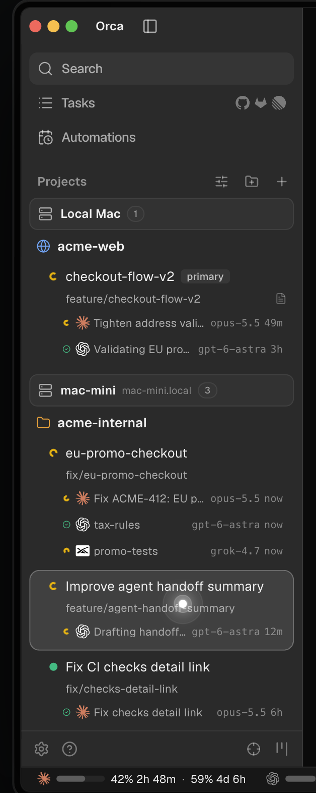

# Product vision — working draft

Carried over from grenada (the standalone prototype) when tmwk became a hard fork of Orca. Orca supplies most of the execution machinery; [main-chat.md](main-chat.md) maps these terms onto it.

This draft captures the intended experience, the agreed Dogfood v1 boundaries, and the questions that remain open. It is a vision, not a roadmap or implementation plan.

This is a personal tool. Its audience today is one person: me.

## The idea

A software development control plane with one main conversation: a trusted technical partner through which I direct agents, using my preferred agent tools and the machines I have connected.

The main conversation is where I express intent and stay oriented. Delegated work has its own persistent place, with enough visibility and control for me to inspect it, redirect it, or work alongside an agent. The system handles routine choices about machines, environments, and execution.

**I should be able to increase the amount of engineering work I direct without having to manage every agent individually.**

I should be able to stay on my laptop while the system runs work on my other environments. Delegated work should continue when I close the laptop and reconnect when I return.

## Scope

This product is a software development assistant. It helps one person operate with the reach of an engineering manager, director, or staff engineer overseeing several streams of work. General personal assistance, such as scheduling a meeting, is out of scope.

It operates within one person's infrastructure: their laptop plus the machines and environments that belong to the same setting. Someone on a work laptop directs work machines and work environments. Someone on a home laptop directs home machines. The product does not span multiple independent infrastructures, clients, or organizations from one installation.

## Delegation model

The analogy is how a staff engineer works: they can engage with anyone, but they usually hand an outcome to a capable engineer and trust them to own it.

The product works the same way. When I delegate a body of work, the main partner hands it to **one agent that owns the ticket**. That agent has the autonomy to operate as it sees fit. It can do the work itself, or start sub-agents, workflows, or parallel workers when that helps. It understands the goal, organizes execution, assesses the results, and brings back decisions that need my judgment. There is no fixed hierarchy of roles and no separate "lead" concept. The owner is simply the agent the work was handed to.

An owner is responsible for:

- Turning direction into a coherent plan and recognizing decisions that need clarification.
- Choosing how to execute, including whether to use sub-agents.
- Handling routine questions, retries, and coordination within its instructions.
- Checking that the pieces fit together and satisfy the original goal.
- Surfacing tradeoffs, blockers, and results with a useful recommendation.
- Staying accountable for the whole ticket, including when sub-agents finish or fail.

An owner that forwards every question back to me has not removed the management burden. It should resolve what it can within its instructions, while keeping its work visible.

The owner runs where the ticket runs, not on my laptop. That is what lets a ticket keep making decisions while the laptop is closed.

The unit of attention is usually the ticket and its outcome. Sessions, worktrees, and machines are available when I want to go deeper.

## Terms

These are draft definitions, to be corrected where they are wrong.

| Term               | Meaning                                                                                                                                                                                                                                                                                                                                |
| ------------------ | -------------------------------------------------------------------------------------------------------------------------------------------------------------------------------------------------------------------------------------------------------------------------------------------------------------------------------------- |
| **Main partner**   | The agent in the main conversation. It answers simple questions directly, delegates bodies of work, and keeps the overview across tickets. It runs on the **home host**: the laptop when remote environments are ephemeral, or an always-on host in a homelab setup. See [main chat placement](main-chat.md#where-the-main-chat-runs). |
| **Ticket**         | A body of engineering work with one goal, in one repository, owned by one agent. A ticket is either finite or ongoing. The term comes from the DeepSeek superagent prototype, where a ticket is "a unit of authorized work." Earlier drafts called this an _effort_.                                                                   |
| **Ongoing ticket** | A ticket that persists between events instead of producing a single deliverable, for example "babysit my PRs and keep CI green." Earlier drafts called this a _responsibility_.                                                                                                                                                        |
| **Owner**          | The single agent a ticket is handed to. It decides how to execute and is accountable for the result.                                                                                                                                                                                                                                   |
| **Sub-agent**      | An agent session the owner starts to carry out part of its ticket. Optional, and always the owner's choice.                                                                                                                                                                                                                            |
| **Session**        | One running instance of an agent tool (Claude Code or Codex). The owner and each sub-agent are sessions. A row in the overview is a session.                                                                                                                                                                                           |
| **Instructions**   | What the owner receives when work is delegated: the goal, relevant context, and constraints, including anything it may or may not do. Standing preferences are included automatically.                                                                                                                                                 |
| **Project**        | A repository the product knows about, together with its accumulated knowledge.                                                                                                                                                                                                                                                         |
| **Host**           | A machine or environment where tickets run: my laptop, an always-on Mac, or an Ona environment.                                                                                                                                                                                                                                        |
| **Work history**   | The retained record of a ticket: instructions, messages, reports, interventions, and links to code and PRs. Both the main conversation and the ticket view read from it.                                                                                                                                                               |

## One conversation, familiar tools, my compute

I value the simplicity of a single chat, as in Grok and Muse. The product pairs that simplicity with familiar development agents, control over where work runs, and visible background work.

- **One main conversation:** the normal place to ask, discuss, delegate, redirect, and get answers across all active work.
- **Familiar agent tools:** I choose a supported agent tool for the main partner and for each ticket. A ticket's owner may use different tools for its sub-agents. I keep working with Claude, Codex, and similar tools through recognizable sessions.
- **My compute:** work runs on my connected machines and environments. The product does not force jobs onto vendor-managed compute.
- **Visible background work:** every ticket can be found, inspected, and redirected. Quiet work stays discoverable even when it needs nothing from me.

Communication is single-threaded; execution is not. Many tickets run concurrently. A long-running ticket must not monopolize the main conversation or stop me from redirecting other work.

Execution location and model inference location are separate decisions. Running a coding agent on a particular host does not imply a locally hosted model.

## Answering versus delegating

The main partner should feel conversational. It answers simple questions itself, such as "what's the status of the settings work?" or "how does this repo handle auth?" Delegating a quick question would make the product feel heavy.

Actual bodies of work, such as implementing, fixing, reviewing, or monitoring, are delegated to an owner. The main partner doesn't do them inline in the main conversation.

## The problem

My development life spans my laptop, an always-on machine, and Ona environments. The remote machines are execution resources. I want to stay on my laptop and let the product handle them, whether there is one environment or ten. Today, using these resources well means remembering where work lives, preparing environments, starting the right tools, and reconnecting to the right sessions. I'd rather the product handled that, without my logging into hosts or managing SSH sessions.

Agent IDEs make parallel work possible, but they can also give me more things to manage: agents, terminals, worktrees, remote hosts, and tabs. If every agent still needs my attention, a bigger team means a bigger management burden. I want access to those tools when they help, and I want the system to carry the coordination during normal use.

## The experience

I open the app and continue a conversation with a partner that understands my active work. I can think out loud, ask a question, or delegate something substantial.

> "Start working on the new settings page. Use the approach we discussed yesterday."

The partner recognizes this as a body of work, establishes a concrete outcome, and hands it to an owner with the relevant context. The owner chooses a suitable host, decides how to execute, and starts. It asks only when a missing decision materially affects the result.

The main conversation gives me a short acknowledgement and a way to open the work. I can keep talking about something else while it runs.

From the main conversation, I can also say "pause the settings work," "what needs me?" or "prioritize the failing PR over the feature." I shouldn't have to find a particular session to direct a ticket.

Opening a ticket shows its purpose, current state, recent progress, and any decision it needs from me. I can ask a question, change direction, pause it, inspect a diff, open a terminal, or work directly with any of its sessions. Those interventions become part of the work history, so the main partner can catch up without my relaying anything. When a host is unreachable, the interface distinguishes the last known state from a fresh report.

I can say how a ticket should run as part of the request:

> "This is a review task. Use Codex on the always-on Mac."
>
> "This is a tricky problem. Use Claude with Opus 5.5."

These choices apply to the relevant ticket. They don't change the agent powering the main conversation. A ticket can include implementation by one agent and review by another.

When the result is ready, the owner brings back the outcome and the evidence needed to assess it. Routine execution detail remains available on demand.

## Instructions and boundaries

For Dogfood v1, a ticket's boundaries are whatever its instructions say. There is no separate permission system. If the instructions say "never open a PR," babysitting PRs still works: the owner investigates and fixes CI failures but doesn't open new PRs. If I say review comments are fine, a reviewer can leave them. Otherwise review output stays inside the ticket.

If an owner is asked to do something it can't do, because of its instructions, missing access, or missing tools, it says so at the start instead of discovering it halfway through.

Standing preferences, such as "never merge without asking me," are instructions I give once. They're included in every ticket's instructions automatically, and I can change them conversationally.

Content that arrives from outside my delegation, such as CI logs, PR comments, issue text, or repository files, is data for the owner to consider, not direction. It can't widen what the owner was told to do.

An enforced permission system that holds even when an agent misbehaves comes after Dogfood v1. It would include scoped grants, merge authorization, and credential isolation.

## Work can be finite or ongoing

Some requests produce a deliverable:

> "Implement this feature and open a PR."

Others hand over an ongoing ticket:

> "Watch my open PRs throughout the day and keep CI green."

An ongoing ticket persists between events. It can wait quietly, notice a failed check, investigate, and start a repair. The owner makes its interpretation visible: which PRs are covered, whether newly opened PRs are included, and how long it will watch. These have sensible defaults and can be set conversationally.

Keeping CI green means fixing the underlying problem while preserving the intended behavior. If the owner can't make progress, it reports the blocker. A healthy ongoing ticket can stay quiet while visibly active.

**When a ticket is done is the owner's call, informed by my preferences.** One person considers "PR opened" to be done; another expects the ticket to keep handling review comments until merge. This isn't hard-coded. The owner learns my preference over time and states its assumption when it matters.

For now, a ticket spans a single repository. Watching PRs across several repositories means one ongoing ticket per repository, all directed from the main conversation.

## Execution continues while the laptop is offline

This applies once remote hosts are connected (stage 2; see [Where work runs, in stages](#where-work-runs-in-stages)). In the local-only MVP, closing the laptop pauses everything, and the product shows that honestly.

The main conversation is where I direct work. Its availability must not determine whether delegated work continues. Closing the laptop, quitting the app, or losing the connection leaves owners, sub-agents, and ongoing tickets running on their hosts.

The acceptance scenario:

1. From my laptop, I ask the main partner to babysit my PRs for the day.
2. The system starts an ongoing ticket on a suitable always-on host, with the instructions and access it needs.
3. I close my laptop and go to lunch. A CI failure occurs. The owner detects it, investigates, pushes a repair, and checks the result, all within its instructions.
4. It keeps its progress, outcomes, and any open questions while disconnected.
5. When I reopen the laptop, the product reconnects to the existing ticket and brings the main partner and the overview up to date. Reconnection never starts duplicate monitoring or repair work.

The requirement is independent execution with asynchronous communication. The owner has enough context to decide things itself without consulting the main partner. An always-on main chat, or shared live state on the laptop, must not be a prerequisite.

When an owner reaches a decision outside its instructions, it keeps the question and waits. Other independent work continues.

## Attention and notifications

This section is a draft.

Something **needs me** when it's one of:

1. **A decision:** the owner has reached something outside its instructions and is waiting.
2. **A stop:** the ticket has failed, can't proceed, or its host is lost.
3. **A result:** a deliverable is ready for me to assess.

Everything else is quiet. It's visible in the overview, but it doesn't generate notifications. "What needs me?" returns those three kinds, in that order.

**While the app is open:** items that need me appear in the main conversation and are marked in the overview.

**While the laptop is closed:** nothing reaches me. There's no mobile or push channel in v1. Questions wait at the ticket and results are held. Work on remote hosts keeps going; work on the laptop pauses until it wakes.

### While I was away

When I reopen the app after time away, the main partner posts **one "while you were away" message** in the main conversation. It covers what happened across all tickets while I was disconnected:

- **Needs me:** decisions waiting, then stops, then results ready, each with a link to its ticket.
- **Handled:** what the owners resolved on their own, such as "fixed 2 CI failures on PR 412," stated briefly.
- **Still running:** quiet tickets that are healthy, as a count or a short list.

It's one message, not a replay of every event. Detail lives in each ticket's work history, and the overview marks which tickets changed. If nothing happened, the message says so in a line, or is skipped.

## The interface stays simple as the work grows

There are three depths:

1. **Main conversation:** set direction, ask questions, delegate outcomes, and ask across active tickets.
2. **Ticket:** work with the owner; see its plan, progress, sub-agents, and pending decisions. Ongoing tickets live here too.
3. **Session:** a single agent's conversation, with diffs, terminal, and preview tools available as needed.

A background overview makes active tickets easy to find and highlights what needs me. It's organized around tickets, with sessions and host details inside each.

### Background work reference: Orca

Orca's sidebar is a reference for making active work readable. Its nested rows show a named body of work with agent sessions underneath. Agent identity, a short activity label, model, status, and timing make it possible to scan what's happening and open a particular session.

We want that degree of visibility, organized primarily around tickets with their sessions beneath them. Machine grouping is optional; the host can appear as secondary information.

A session row should answer:

- What is this agent working on, or what part does it play in the ticket?
- Which agent tool and model is it using?
- Is it working, queued, waiting for an event, waiting for me, blocked, or finished?

Agent identity and status need distinct indicators. The model and timing are supporting information.

### Watching and working alongside agents

Working with agents should feel like Claude Code's sub-agents in tmux panes: when the owner has sub-agents running, I can watch several sessions working at once, and I can type into any of them. My input is just another message to that session, recorded in the work history so the owner sees it. I don't need a formal "take control" step to get hands-on, or a "hand back" step to step away.

Different agent tools offer different capabilities, but the product presents their activity and lifecycle consistently enough to understand a mixed set of sessions.

The number of sessions and the number of worktrees are separate. The owner decides that mapping; I don't have to.

## Machines and agents

Connected hosts form a pool of places where work can run. My laptop is a host too. The system knows each host's availability, capabilities, and projects.

### Default placement

Placement is automatic by default, explainable when inspected, and can be overridden. I can say "run this on the always-on Mac" without being required to choose for every request.

1. **An explicit choice wins.** If I name a host, or say something that implies one, the ticket goes there. If that host can't take it, the system explains why and offers an alternative instead of substituting silently.
2. **Only eligible hosts are considered.** A host must be online, have the repository (or be able to clone it), and have the requested agent tool installed and authenticated. An ongoing ticket also needs an always-on host.
3. **Among eligible hosts, prefer:**
   1. one that already has the repository checked out
   2. an always-on host over one that sleeps or auto-stops
4. **If no host is eligible,** the system says what's missing. It doesn't silently wait.

The laptop counts as eligible, but it isn't always-on. A ticket running there pauses when the lid closes, and the ticket shows that.

Ona environments usually map one-to-one to a repository, so the repository filter does most of the work. They auto-stop by default. A host is marked always-on when I've configured it that way, which is easy for an Ona environment.

The reason for each placement is recorded on the ticket, so "why is this running there?" always has an answer. Load-aware placement, using session caps or resource use, comes later.

Agent tool, model, and host are separate choices. I can specify any of them conversationally; the system fills in the rest with sensible defaults. An explicit choice is respected. If the requested combination is unavailable, the system explains why and offers an alternative instead of silently substituting.

Dogfood v1 supports Claude Code and Codex. Pi and OpenCode come later. Supporting a tool means being able to launch its sessions, deliver instructions, show meaningful activity and state, and let me interact directly.

A coding ticket may need a worktree. Monitoring may need no checkout until there's something to fix. The system prepares what the work requires.

### Where work runs, in stages

1. **Local MVP:** everything runs on my laptop. The main partner, tickets, owners, and sub-agents all live there. This proves the core experience (one conversation, delegating tickets, watching and stepping into sessions, memory) before adding distribution. It's built so that the laptop is simply the first host, not a special case.
2. **Remote hosts:** connect already-provisioned boxes, such as an always-on Mac or an Ona environment switched to always-on. Tickets run there, survive the laptop closing, and reconnect afterward. This stage delivers the lunch scenario.
3. **Later:** recognize when hosts are at capacity, and provision more Ona environments or route work to a better-suited host. Working across ten environments without thinking about them is the long-term goal.

### When a host goes away

Dogfood v1 provides no recovery or migration when a host is lost or its ephemeral environment disappears. Work on a lost host is treated as unrecoverable and reported honestly. History and artifacts already synchronized elsewhere are retained; unsynchronized state and unpushed changes may be lost. A temporary communication outage is shown as disconnected, with last known state, not as a lost host. A stopped or suspended environment is a third state, distinct from both.

## Context and memory

Within one installation, preserve as much useful context as practical across conversations, tickets, and projects. This includes conversation history, instructions and preferences, project knowledge, decisions and their rationale, plans, reports, results, and links to code and PRs. Returning to a ticket should not require reconstructing its purpose, and a relevant lesson from one ticket should be available to another.

Persistence is broader than what fits in an agent's active context. A single main conversation can be backed by stored history, summaries, and retrieved knowledge, so that it feels continuous as the history grows.

Owners receive the context relevant to their ticket and keep enough of it to work independently. On reconnection, their reports and history become available to the main partner.

OpenClaw documents a rolling main conversation; Hermes combines saved sessions, curated memory, and history search. Our application is one main partner backed by retained records and focused recall. See [conversation and memory research](research/agent-context.md). Neither tool's native memory automatically gives Claude and Codex a shared context; that bridge has to be built deliberately.

## Principles

- **Delegate outcomes.** The normal starting point is what I want accomplished.
- **One owner per ticket.** The agent a ticket is handed to decides how to execute it and is accountable for the result.
- **Protect attention.** Tell me when I need to decide, when progress has stopped, or when a result is ready.
- **Keep quiet work visible.** Healthy tickets are easy to find and inspect without generating notifications.
- **Make autonomy inspectable.** I can see what's happening, why, and where, and can step in.
- **Run independently.** Work on remote hosts continues without my laptop or the main partner staying online.
- **Preserve continuity.** Reconnecting, inspecting a session, and returning to the main conversation never require repeating context or restarting work.
- **Use sensible defaults.** Routine orchestration requires few decisions; meaningful constraints stay easy to express.
- **Instructions bound the work.** An owner does what it was told, flags up front what it can't do, and treats outside content as data rather than direction.
- **One writer per branch.** Only one ticket writes to a given branch at a time. (Enforcement is post-v1.)
- **Describe state honestly.** Working, waiting, blocked, disconnected, and finished mean different things. An ongoing ticket is active even when no agent is currently running.

## What success feels like

The dogfood measure is simple: **I keep using it.**

The experiences that should make that happen:

- Once remote hosts are connected: I start PR babysitting from my laptop, close it for lunch, and return to find CI failures were handled while I was away.
- I reopen the app, reconnect to existing work, and get an accurate account of what happened without restarting anything.
- I rarely need to remember which machine has a task or which session to reopen.
- I hand off a ticket and the owner runs it without my checking on its sub-agents.
- I can get deeply involved in a difficult task and then step back without starting over.
- I get a considered recommendation when a decision needs me.
- More concurrent work doesn't create proportionally more coordination or notifications.
- The main conversation stays responsive while several tickets run.
- I can have one agent implement and another review, watch both, and open either session directly.

## Dogfood v1 decisions

| Topic                   | Decision                                                                                                                                                                      |
| ----------------------- | ----------------------------------------------------------------------------------------------------------------------------------------------------------------------------- |
| Audience                | A personal tool for one user.                                                                                                                                                 |
| Infrastructure boundary | One person's laptop and the hosts within the same infrastructure. No multi-org or work/personal mixing.                                                                       |
| Delegation              | Each ticket has one owner agent that decides how to execute, including whether to use sub-agents. No lead hierarchy.                                                          |
| Main partner            | Answers simple questions directly; delegates bodies of work.                                                                                                                  |
| Agent tools             | Claude Code and Codex first; Pi and OpenCode later.                                                                                                                           |
| Boundaries              | Defined by instructions and standing preferences. No enforced permission system in v1.                                                                                        |
| Ticket completion       | Decided by the owner, informed by learned user preferences. Not hard-coded.                                                                                                   |
| Ticket scope            | One repository per ticket.                                                                                                                                                    |
| MVP                     | Local only: everything runs on the laptop. Remote hosts are the next stage.                                                                                                   |
| Laptop offline          | From stage 2, work on remote hosts continues and reconnects afterward. Work on the laptop pauses. No notifications while offline.                                             |
| Returning               | One "while you were away" summary in the main conversation; detail stays in each ticket.                                                                                      |
| Hosts                   | The laptop, plus already-provisioned hosts from stage 2. Placement: explicit choice, then eligibility, then prefer an existing checkout and always-on. No load awareness yet. |
| Host lost               | No recovery or migration in v1. Reported honestly as unrecoverable.                                                                                                           |
| Context                 | Preserve as much useful history and knowledge as practical within one installation.                                                                                           |

## Deferred past Dogfood v1

- Enforced permissions: scoped grants, merge authorization, credential isolation.
- Branch locking to enforce one writer per branch across tickets.
- Cost, usage quota, and rate-limit awareness.
- Stall detection: noticing an agent that is busy but not making progress.
- Provisioning new Ona environments when existing hosts are at capacity.
- Host recovery and migration.
- Tickets spanning more than one repository.
- Notifications that reach me when the laptop is closed.
- Pi and OpenCode support.
- Load-aware placement (session caps or resource use).
- How standing preferences are learned: proposed and confirmed, or inferred and applied. Until then, I state preferences explicitly.

## Design direction

[The main chat design](main-chat.md) covers how this vision is built on top of Orca. Grenada's earlier standalone design (persistent runners, retained history, reconnection) is in the [grenada repository](https://github.com/tmwkdev/tmwk/blob/main/docs/DOGFOOD_V1_PROPOSAL.md).

## References

- [Ona](https://ona.com/): connected execution environments and background work. It motivates treating compute as available infrastructure.
- [Orca](https://www.onorca.dev/) and its [source repository](https://github.com/stablyai/orca): multiple agent tools, isolated workspaces, remote execution, and the nested work/session sidebar. We want those capabilities behind a simpler everyday experience.
- [DeepSeek superagent prototype](https://github.com/deepseek-ai/dsh-superagent-prototype): persistent work with focused human involvement, and an explicit emphasis on conserving attention. Patterns worth borrowing:
  - **Conserve attention:** few concepts and settings, with messages only when a person needs to act or can use a result ([philosophy](https://github.com/deepseek-ai/dsh-superagent-prototype/blob/main/docs/000-philosophy.md)).
  - **Separate direction from execution:** routing in a main session, execution in per-ticket sessions ([architecture](https://github.com/deepseek-ai/dsh-superagent-prototype/blob/main/docs/007-architecture.md)).
  - **Give work an independent lifetime:** a ticket separate from whoever executes it ([domain model](https://github.com/deepseek-ai/dsh-superagent-prototype/blob/main/docs/001-domain.md)).
  - **Continue from events:** work that waits and resumes on PR activity ([execution model](https://github.com/deepseek-ai/dsh-superagent-prototype/blob/main/docs/003-execution.md)).
- [OpenClaw](https://docs.openclaw.ai/) and [Hermes](https://hermes-agent.nousresearch.com/): conversation and memory patterns. See the [research notes](research/agent-context.md).

References are inspiration, not proposed dependencies.
