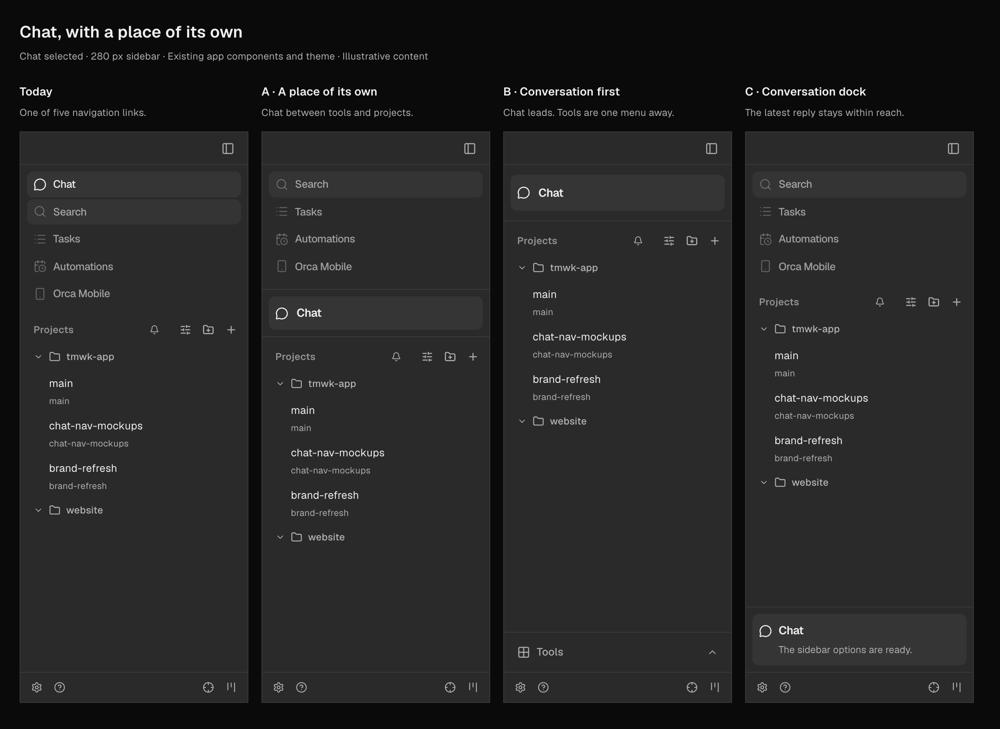
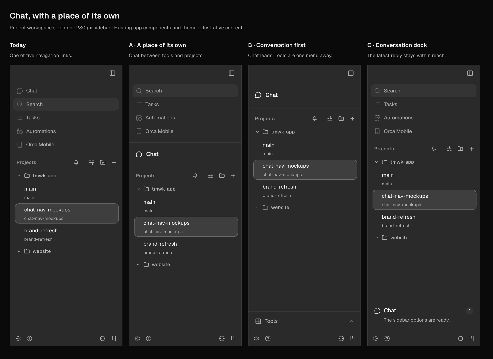
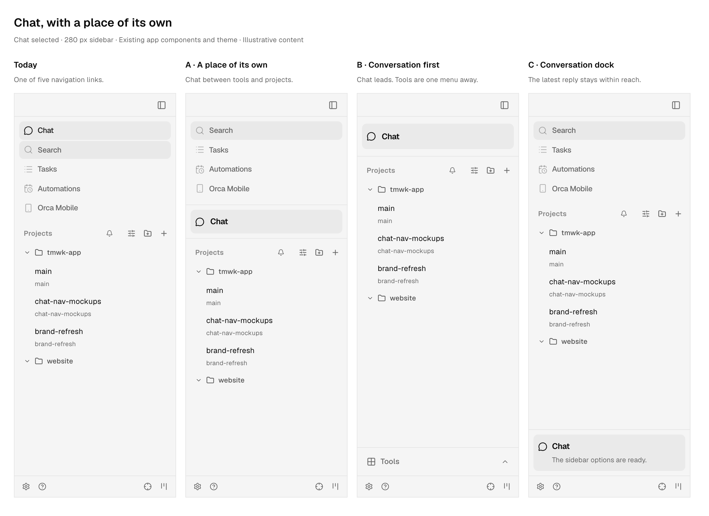
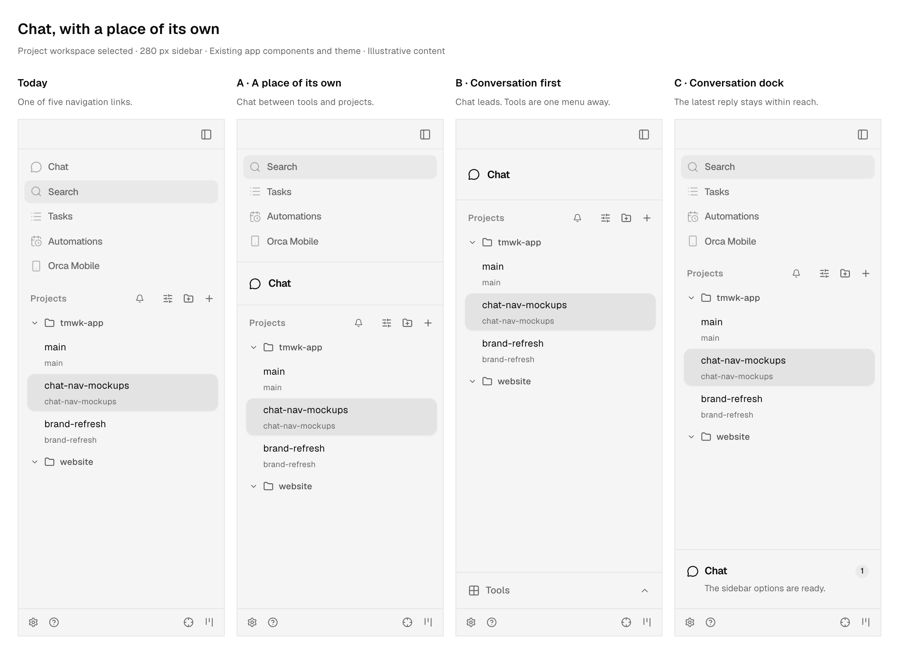

# Chat navigation mockups

Three directions for making **Chat** the place you work through. The aim is Orca's power with the simplicity of a persistent assistant. These are visual proposals only; no app behavior is changed.

**Start with B.** It makes Chat the first destination and puts the machinery behind one Tools menu. A tests the suggested placement below Orca Mobile; C tests a conversation that stays present while you work elsewhere.

## Compare

Each sheet shows today's layout, A, B, and C at the same 280 × 700 CSS-pixel sidebar size. Click an image for the full-resolution PNG.

### Chat selected · dark



### Project workspace selected · dark



### Chat selected · light



### Project workspace selected · light



## A · A place of its own

Chat lives below Orca Mobile and above Projects, in a distinct band with a single label and the existing conversation icon. A stronger label, aligned icon, breathing room, and quiet separators give it its own role without adding a card or an explanation.

**Trade-off:** all utility links remain exposed above it, so this improves separation more than overall simplicity; Projects moves slightly lower. It keeps the existing one-click paths and is the smallest change, but only partly meets the simplicity goal.

**Produced by:** moving the actual Chat button out of `SidebarNav` into a separate band; the other navigation rows remain unchanged. OpenClaw's separation of conversations from operational pages informed the grouping, rather than its visual branding.

## B · Conversation first

Chat anchors the top; Projects sits directly below it. Search, Tasks, Automations, and Orca Mobile move into a compact Tools menu above the existing bottom toolbar, using the same dropdown primitives as the worktree context menu.

**Trade-off:** these utility pages take two clicks instead of one; discovery and keyboard access would need care in implementation. It best meets the simplicity goal: the everyday surface says Chat and Projects, and Orca's tools stay available underneath.

**Produced by:** retaining the actual Chat button and project components, removing the utility stack from the screenshot layout, and adding a real shadcn dropdown. OpenClaw's conversation-first navigation and Grok Bot/Dots' direct relationship with an agent informed this direction; the worktree menu supplied the grouped rows, separators, icon scale, radius, and elevation.

Tools open: [dark](images/btools-dark.png) · [light](images/btools-light.png).

## C · Conversation dock

Chat becomes a persistent conversation at the bottom of the sidebar, above the toolbar. The most recent reply gives you a reason to return; the workspace-selected state illustrates one unread reply, which clears in the Chat-selected view.

**Trade-off:** this preserves more of the existing navigation's complexity and makes Chat a fixed return point rather than the first place your eye lands. It needs a real latest-reply/unread source before implementation; the preview and count here are illustrative, not claims about the user's session.

**Produced by:** moving the actual Chat button into a fixed bottom band and adding an illustrative recent-message preview and unread count. Duet's ongoing thread, Dots' continuity across work, Grok Bot's colleague-like messaging, and Hermes' recent-conversation previews informed the idea. No new conversation, model, or agent picker is introduced.

## Individual screenshots

| Layout | Chat · dark                       | Workspace · dark                     | Chat · light                       | Workspace · light                     |
| ------ | --------------------------------- | ------------------------------------ | ---------------------------------- | ------------------------------------- |
| Today  | [PNG](images/today-chat-dark.png) | [PNG](images/today-project-dark.png) | [PNG](images/today-chat-light.png) | [PNG](images/today-project-light.png) |
| A      | [PNG](images/a-chat-dark.png)     | [PNG](images/a-project-dark.png)     | [PNG](images/a-chat-light.png)     | [PNG](images/a-project-light.png)     |
| B      | [PNG](images/b-chat-dark.png)     | [PNG](images/b-project-dark.png)     | [PNG](images/b-chat-light.png)     | [PNG](images/b-project-light.png)     |
| C      | [PNG](images/c-chat-dark.png)     | [PNG](images/c-project-dark.png)     | [PNG](images/c-chat-light.png)     | [PNG](images/c-project-light.png)     |

## Research and craft references

Read on November 19, 2026. These are design interpretations of the products' own descriptions, not copies of their interfaces.

| Reference                                                                                                                                                                                                                                                         | What informed the proposals                                                                                                                                                                          |
| ----------------------------------------------------------------------------------------------------------------------------------------------------------------------------------------------------------------------------------------------------------------- | ---------------------------------------------------------------------------------------------------------------------------------------------------------------------------------------------------- |
| [OpenClaw: the new web UI](https://docs.openclaw.ai/releases/2026.8.1/the-new-web-ui)                                                                                                                                                                             | Conversations become the center; setup and live work stay nearby. A separates Chat from utilities; B removes their competition from the top.                                                         |
| [Grok Bot 101](https://x.ai/bot/guides/grok-bot-101)                                                                                                                                                                                                              | A persistent agent is approached through messaging, routines, and other agents. B keeps messaging foremost and puts operational tools one menu away; C treats Chat like a conversation to return to. |
| [Introducing dots](https://openai.com/index/introducing-dots/)                                                                                                                                                                                                    | One agent can keep working across projects without requiring the user to manage separate threads. B and C keep one Chat entry, with no session taxonomy or scope explanation.                        |
| [Introducing Claude Duet](https://claude.com/resources/articles/claude-duet)                                                                                                                                                                                      | An ongoing thread carries both quick replies and longer work; the agent can bring things to your attention. C explores a recent-reply return point.                                                  |
| [Hermes web dashboard](https://hermes-agent.nousresearch.com/docs/user-guide/features/web-dashboard)                                                                                                                                                              | Recent sessions include conversation previews; session controls are separated from the conversation switcher. C borrows the preview principle without adding a session list.                         |
| [WorktreeContextMenuView](../../../src/renderer/src/components/sidebar/workspace-actions/context-menu/WorktreeContextMenuView.tsx) and [its fixture](../../../src/renderer/src/components/sidebar/workspace-actions/context-menu/WorktreeContextMenu.fixture.tsx) | Rendered and inspected in both themes as the local craft reference. Its compact grouped actions, aligned inherited-color icons, separators, and standard dropdown surface are reused directly in B.  |

The discarded first draft reintroduced terminology the user had already retired and relied on larger boxes plus explanatory copy. This set keeps the label **Chat**, removes that copy, and explores navigation hierarchy, progressive disclosure, and conversational continuity instead.

## How these were made

- Component-fixture screenshots from renderer snapshot `b4041c2dfbf`, matching the relevant sidebar code on `origin/main` at review time. Headless Chromium via the repo's fixture runner; 2× pixel scale, no Electron window or desktop focus changes.
- Today's navigation, Chat entry, Projects toolbar, workspace cards, and bottom toolbar are the real React components. Workspace data is seeded, project-name rows and the neutral top strip are composed for the mockup, and onboarding badges are dismissed. These are isolated sidebar renders, not captures of the user's live workspace.
- All proposals use the same components, Geist font, Lucide icons, and canonical light/dark tokens from [main.css](../../../src/renderer/src/assets/main.css). No app theme or product assets changed.
- [sidebar-preview.tsx](sidebar-preview.tsx) is the retained render source. [render.mjs](render.mjs) copies it into the **Own** main-chat fixture directory temporarily, captures the 22 PNGs, then removes the temporary fixture and stops this checkout's fixture server. Layout rearrangements happen only inside the fixture after paint.

From the repository root, with dependencies installed and a headless Chromium or Chrome available:

```sh
ORCA_BACKGROUND_LAUNCH=1 node docs/tmwk/chat-nav-mockups/render.mjs
```

The script restarts this checkout's fixture server to avoid stale module captures. It leaves no source changes outside this directory; `git status --short` can confirm. These images do not exercise navigation behavior, latency, mobile drawers, or platform-specific window chrome; those checks belong to a chosen implementation.
