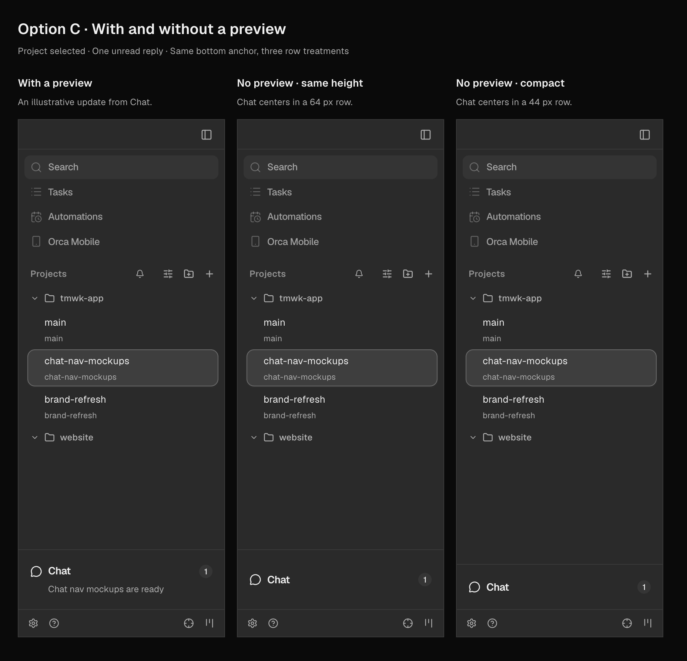
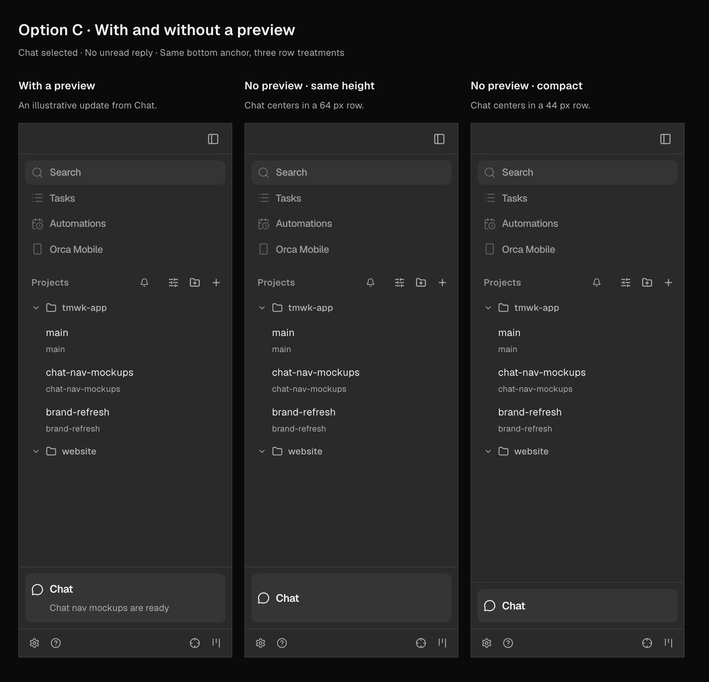
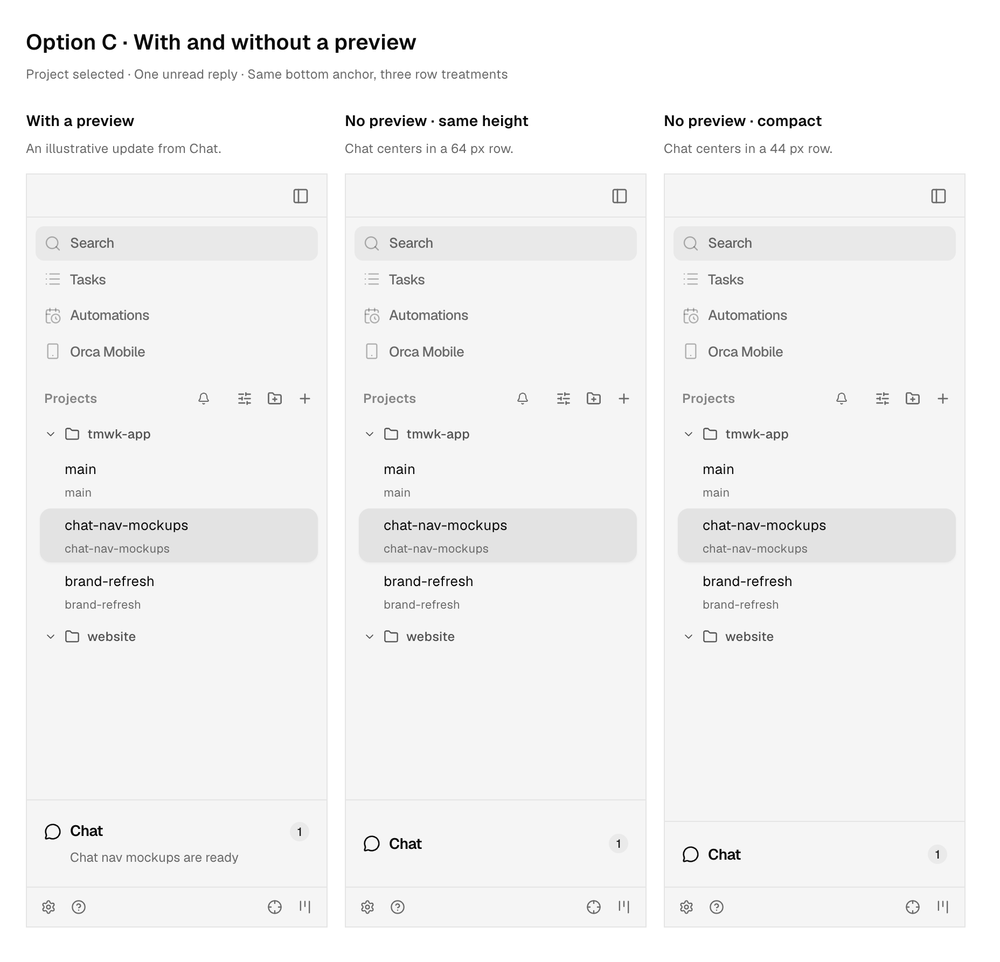
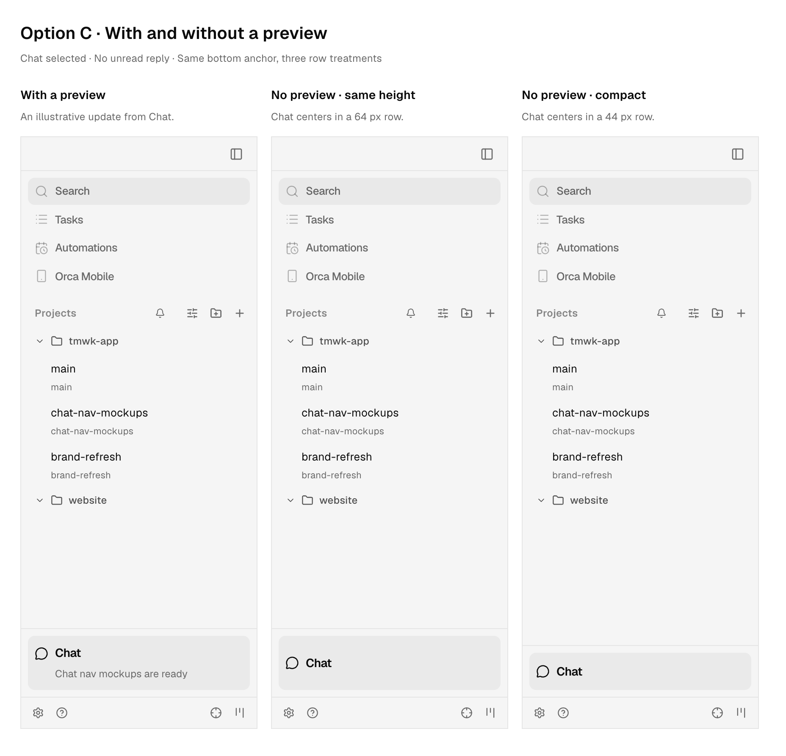
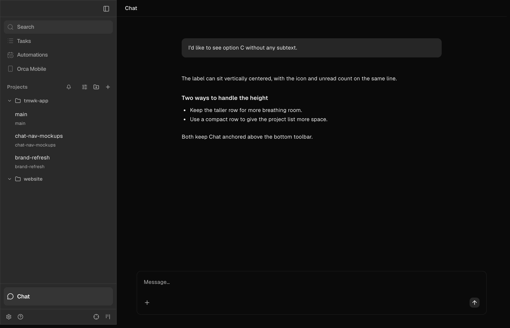
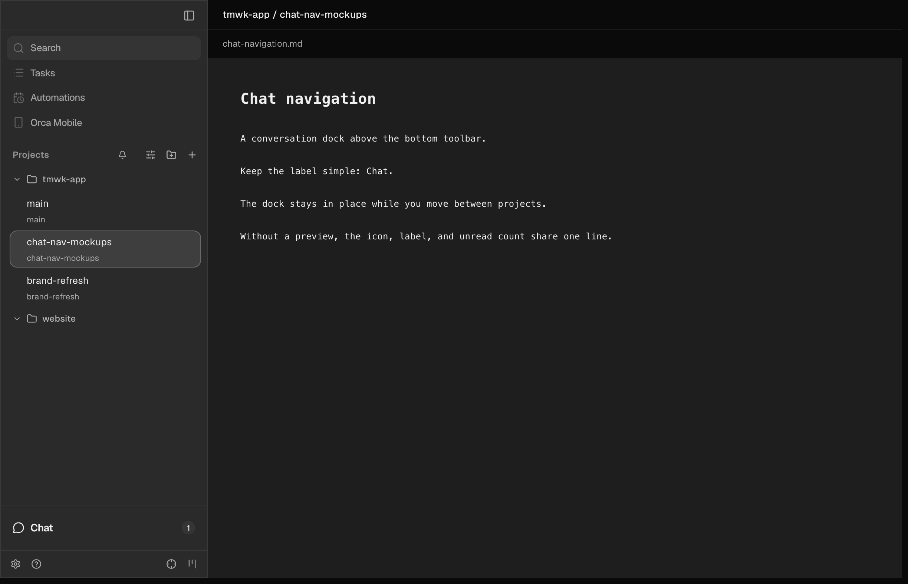
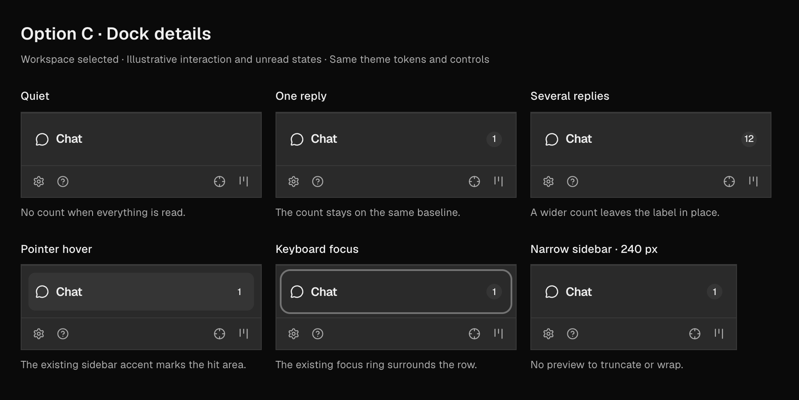

# Option C · With and without a preview

**Yes: without subtext, Chat centers vertically within its row.** The conversation icon and unread count center with it. The dock stays anchored immediately above the bottom toolbar; it does not move to the middle of the sidebar.

Two ways to handle the space:

| Treatment                | Chat row | Result                                                                                                 |
| ------------------------ | -------- | ------------------------------------------------------------------------------------------------------ |
| With a preview           | 64 px    | Two lines: Chat, then the latest update. The example uses “Chat nav mockups are ready”.                |
| No preview · same height | 64 px    | Chat centers in the space previously occupied by both lines. More breathing room, same dock footprint. |
| No preview · compact     | 44 px    | Chat centers in a shorter row. The project list gets 20 px back.                                       |

**I prefer the compact version when the preview is off.** It is a clear, permanent destination with a generous hit area, and it leaves no empty second-line space. The same-height version gives Chat more presence if that is the priority. All three use the same icon, type weight, inset, bottom toolbar, and selection treatment.

## Full sidebar comparisons

Left to right: preview, no preview at the same height, no preview compact. Both selection states and themes are shown; the project list and utility navigation are identical across the three columns.

### Project workspace selected · dark



### Chat selected · dark



### Project workspace selected · light



### Chat selected · light



## Compact version in context

The sidebar uses the actual renderer components. The conversation, document, and composer beside it are composed context to judge the dock in a full window; they are not a proposal to restyle those app surfaces.

### Working in Chat



[Light theme](images/c-context-chat-light.png)

### Working in a project



[Light theme](images/c-context-project-light.png)

## Dock details



[Light theme](images/c-states-light.png)

- With no preview, the row contains only the conversation icon, **Chat**, and an unread count when needed.
- Selecting Chat uses the existing sidebar accent. Selecting a workspace leaves Chat unselected, while its place above the toolbar stays fixed.
- The count shares the label's vertical center; it does not create a second line. No count appears when everything is read.
- Hover uses the existing sidebar accent; keyboard focus uses the existing focus ring. The mockups illustrate those appearances, not a keyboard-navigation implementation.
- The 240 px example retains the same layout without any preview wrapping or truncation.
- If preview visibility becomes a setting, hide/show should affect only this line. It should not change the conversation, unread state, or the destination opened by the row. The compact layout intentionally changes height by 20 px; the same-height layout avoids that change.

Unread counts and the sample update are illustrative. A visibility setting, live latest-update source, and unread behavior remain implementation work; this PR only contains mockups.

## Individual PNGs

| Treatment               | Chat · dark                            | Workspace · dark                          | Chat · light                            | Workspace · light                          |
| ----------------------- | -------------------------------------- | ----------------------------------------- | --------------------------------------- | ------------------------------------------ |
| Preview                 | [PNG](images/c-preview-chat-dark.png)  | [PNG](images/c-preview-project-dark.png)  | [PNG](images/c-preview-chat-light.png)  | [PNG](images/c-preview-project-light.png)  |
| Same height, no preview | [PNG](images/c-centered-chat-dark.png) | [PNG](images/c-centered-project-dark.png) | [PNG](images/c-centered-chat-light.png) | [PNG](images/c-centered-project-light.png) |
| Compact, no preview     | [PNG](images/c-compact-chat-dark.png)  | [PNG](images/c-compact-project-dark.png)  | [PNG](images/c-compact-chat-light.png)  | [PNG](images/c-compact-project-light.png)  |

## Reproduce

The original renderer snapshot and component-fixture approach are described in the [gallery notes](README.md#how-these-were-made). [conversation-dock-study.tsx](conversation-dock-study.tsx) composes the existing [sidebar preview](sidebar-preview.tsx); no app code is modified.

```sh
ORCA_BACKGROUND_LAUNCH=1 node docs/tmwk/chat-nav-mockups/render.mjs --c-only
```

This captures the 22 additional C images at 2× scale with headless Chromium. Comparison sidebars are 280 × 700 CSS pixels; context windows are 1216 × 780. The narrow detail is 240 px wide. Running without `--c-only` regenerates all 44 images, including the original alternatives. The renderer's temporary files are removed afterward.
