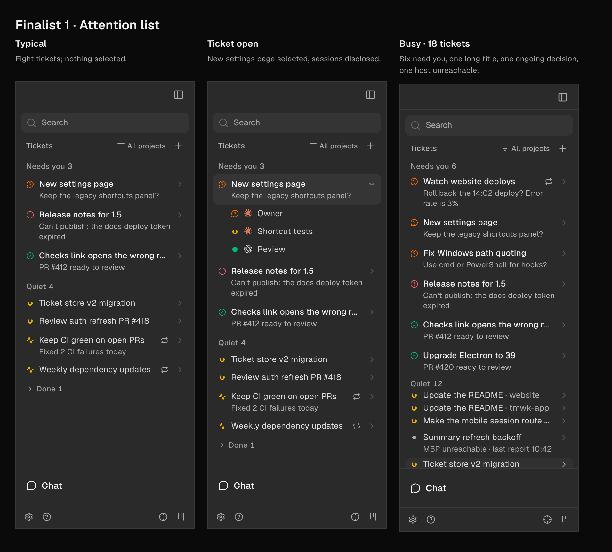
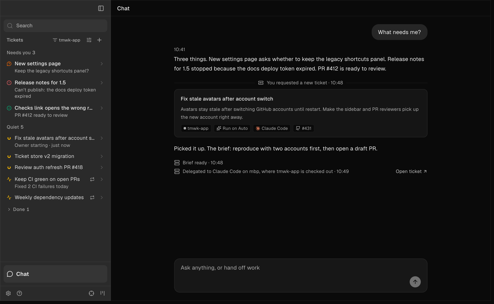
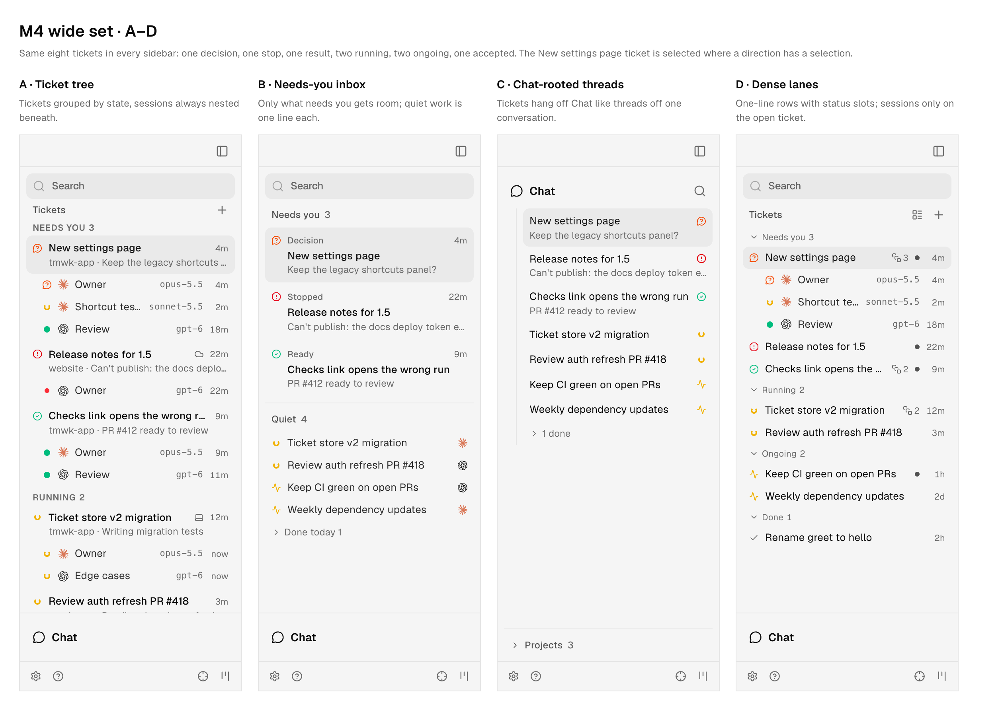
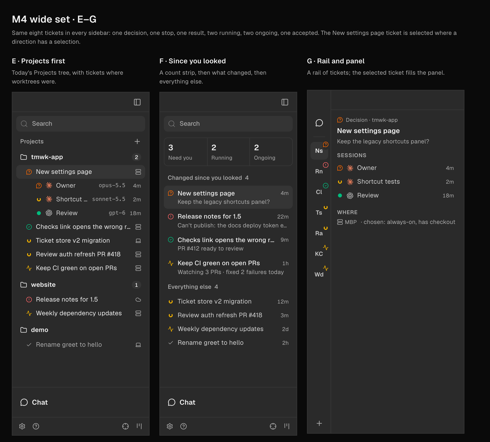

# M4 design spike: the ticket-first overview

M4 in [main-chat.md](../main-chat.md#milestones): "The sidebar is organized by ticket, with sessions beneath, as described in VISION." This spike explores how that looks and behaves, as design prototypes rendered from real components. No app code changes.

The spike went wide first: eight directions, critiqued by Codex. It then narrowed to three finalists, critiqued by Codex again, and ends with one recommendation.

## Recommendation

**Ship [Finalist 1 · Attention list](directions/f1-attention-list.md) with the [conversation-and-rail ticket view](directions/ticket-view.md).**



- **One list under "Tickets":**
  - **Needs you:** decisions, then stops, then results. Each row carries the actual question, blocker or result as its second line.
  - **Quiet:** every other active ticket, one line each. An ongoing ticket marks itself with a repeat icon and says what it handled.
  - **Done:** collapsed to one row.
- **Sessions sit beneath their ticket** behind a separate disclosure chevron, showing status, agent and role. Models, placement and the code live in the ticket view.
- **Hosts appear only when they explain something:** a stop, or an unreachable host with its last report time. **Projects are a filter**, not a grouping, and a project name appears only when titles collide.
- **Chat keeps today's compact dock** (PR #34). Its "What needs me?" answer and the Needs you section come from the same tickets.
- **Opening a ticket shows the owner's conversation:**
  - the work history is the thread, the decision is an inline card with one-click answers, and the composer says "Message the owner";
  - a quiet rail holds Sessions (Watch all), Code and Where;
  - "Watch all" opens every session side by side, each one typeable.

**Why this one.** It reads VISION most directly. The ticket is the unit of attention, and the list order is the "What needs me?" order. Quiet work stays visible but cheap. Sessions, machines and worktrees are one deliberate step deeper. That is the brief, "the power of Orca and the simplicity of grokbot/dots": Orca's sessions, agents and hosts are all reachable, while the surface you scan is a short list of outcomes and one conversation.

**The close alternative is [Finalist 2 · Chat on top](directions/f2-chat-on-top.md).** It has identical rows; only Chat's position changes. If dogfooding shows that the bottom dock makes Chat too slow to return to, moving it to the top is a small change. Codex ranked F1 first and F2 a "close second."

**States the recommendation was tested in** (rendered, dark and light):

| State                                                                                                               | Image                  |
| ------------------------------------------------------------------------------------------------------------------- | ---------------------- |
| Typical: 8 tickets, 3 need you                                                                                      | `f1-states-a` (left)   |
| Ticket selected, sessions disclosed                                                                                 | `f1-states-a` (middle) |
| Busy: 18 tickets, 6 need you, long title, duplicate titles, an ongoing ticket with a decision, one host unreachable | `f1-states-a` (right)  |
| Nothing needs you                                                                                                   | `f1-states-b` (left)   |
| MBP unreachable: last known state, open questions kept                                                              | `f1-states-b` (middle) |
| Empty: first launch                                                                                                 | `f1-states-b` (right)  |
| Ticket open: decision pending                                                                                       | `f1-ticket-open`       |
| Chat open beside the list                                                                                           | `f1-chat-open`         |
| Watch all sessions                                                                                                  | `open-watch`           |

**Not tested,** because PNGs cannot show it or it was not drawn:

- **Behavior:** scrolling at 18+ tickets, keyboard and touch disclosure, and selection and scroll preservation when priority changes.
- **Layout:** narrow and mobile layouts.
- **Host and environment states:** reconnecting, a stopped or suspended environment versus a lost host, laptop sleep pausing local tickets, and failed answer delivery.
- **Other gaps:** filtered-empty results, evidence beside result acceptance, and where folder workspaces and raw worktrees are reached once Projects becomes a filter.

These are the first questions for the implementation plan.

### Round 3: New ticket, Ticket options, status order

After round 2 the user approved three follow-ups. They are drawn on top of F1, with the same row grammar, and critiqued by Codex once more.



- **[New ticket](directions/r3-new-ticket.md).** The sidebar's + opens a sheet built from Create worktree's parts. "What should get done?" is the large first field and the only required one. The project comes from the filter, Run on defaults to Auto and Agent to your default. Create from is an optional search, there is no branch naming, Create more stays, and Save as draft is cut. Submitting opens Chat, where the request lands as a **timeline event, not a message**. The partner briefs and delegates ("Brief ready", "Delegated to … on mbp") or asks one real question, which waits in Needs you.
- **[Ticket options](directions/r3-ticket-options.md)** replace Workspace options in the same menu grammar:
  - Group by Attention (default), Status, Project, Host or None. Sort within a group, row density, Show on rows, and Hide done, ongoing or quiet.
  - Two rules hold everywhere: needs-you rows always keep their reason, and filters never hide what needs you.
  - Worktree-only options move to the worktree view.
- **[Custom status order](directions/r3-ticket-options.md#custom-status-order).** With Group by Status, "Status order…" opens a popover where you drag sections (Done, then Blocked, then the rest) or move them with ⌥↑↓, and the order is saved for you. **Guardrail:** every grouping except Attention pins a "Needs you N" strip above all sections, and decisions still arrive in Chat.

| Round 3 state                                       | Image                |
| --------------------------------------------------- | -------------------- |
| New ticket over the app, + highlighted, filled in   | `new-ticket-sheet`   |
| Today's New worktree beside New ticket, Run on open | `new-ticket-compare` |
| Request as an event → plan → delegated → Quiet row  | `new-ticket-chat`    |
| Partner asks first; the ticket waits in Needs you   | `new-ticket-clarify` |
| Workspace options (real) beside Ticket options      | `options-compare`    |
| Sort within group and Show on rows open             | `options-submenus`   |
| Default, Project one-line, Host with details        | `options-results`    |
| Status order mid-drag; your order; default order    | `status-order`       |

**Round 3 not tested:**

- the pinned strip while scrolling;
- decision delivery to Chat under a reordered list;
- Create more reopening the sheet over Chat;
- Enter versus ⌘↵ in the description;
- failed delegation;
- the active-filter badge and filtered-empty recovery in Ticket options.

## All directions

| Direction                                                               | Verdict                            | Images                                                                            |
| ----------------------------------------------------------------------- | ---------------------------------- | --------------------------------------------------------------------------------- |
| [A · Ticket tree](directions/a-ticket-tree.md)                          | Cut (subtree kept as disclosure)   | `wide-a`, `wide-sheet1`                                                           |
| [B · Needs-you inbox](directions/b-needs-you-inbox.md)                  | Merged into F1                     | `wide-b`, `wide-sheet1`                                                           |
| [C · Chat-rooted threads](directions/c-chat-rooted-threads.md)          | Became F2                          | `wide-c`, `wide-sheet1`                                                           |
| [D · Dense lanes](directions/d-dense-lanes.md)                          | Merged into F1                     | `wide-d`, `wide-sheet1`                                                           |
| [E · Projects first](directions/e-projects-first.md)                    | Cut (projects became a filter)     | `wide-e`, `wide-sheet2`                                                           |
| [F · Since you looked](directions/f-since-you-looked.md)                | Cut (handled summary kept)         | `wide-f`, `wide-sheet2`                                                           |
| [G · Rail and panel](directions/g-rail-and-panel.md)                    | Cut (panel became the ticket rail) | `wide-g`, `wide-sheet2`                                                           |
| [H · Tickets page](directions/h-tickets-page.md)                        | Cut for M4                         | `wide-h`                                                                          |
| [F1 · Attention list](directions/f1-attention-list.md)                  | **Recommended**                    | `f1-states-a`, `f1-states-b`, `f1-ticket-open`, `f1-chat-open`                    |
| [F2 · Chat on top](directions/f2-chat-on-top.md)                        | Alternative                        | `f2-states-a`, `f2-states-b`                                                      |
| [F3 · Shelf and queue](directions/f3-shelf-and-queue.md)                | Not recommended                    | `f3-typical`, `f3-busy`, `f3-quiet`                                               |
| [Ticket views T1–T4](directions/ticket-view.md)                         | T4 recommended                     | `open-page`, `open-conversation`, `open-watch`, `f1-ticket-open`                  |
| [R3 · New ticket](directions/r3-new-ticket.md)                          | Recommended (user-approved)        | `new-ticket-sheet`, `new-ticket-compare`, `new-ticket-chat`, `new-ticket-clarify` |
| [R3 · Ticket options and status order](directions/r3-ticket-options.md) | Recommended (user-approved)        | `options-compare`, `options-submenus`, `options-results`, `status-order`          |

Every image is in [`images/`](images/) as `<name>-dark.png` and `<name>-light.png` at 2× scale.




## Codex critique rounds

Codex ran as an Orca helper worker on this worktree, given the images and a brief, and asked for blunt critique against VISION and the simplicity principle.

| Round              | Brief                                         | Critique                                      | What changed                                                                                                                                                                                                                                                                                                                                                                              |
| ------------------ | --------------------------------------------- | --------------------------------------------- | ----------------------------------------------------------------------------------------------------------------------------------------------------------------------------------------------------------------------------------------------------------------------------------------------------------------------------------------------------------------------------------------- |
| 1 · wide set (A–H) | [round-1-brief.md](critique/round-1-brief.md) | [round-1-codex.md](critique/round-1-codex.md) | B+D merged into F1; C revised into F2; its "persistent work shelf" idea built as F3; ongoing became a kind, not a state; ages, logos and models left the rows; sessions became an explicit disclosure; hosts only when they explain a problem; projects became a filter; new states (busy, unreachable, empty, nothing needs you).                                                        |
| 2 · finalists      | [round-2-brief.md](critique/round-2-brief.md) | [round-2-codex.md](critique/round-2-codex.md) | F1 ranked first and T4 chosen. Fixed: Chat and list now agree; "Running" became "Quiet"; two-line reasons; consistent disclosure; distinct stop/result shapes; project shown on title collisions; actionable empty state; a stop that is really a stop; leaked-sounding title renamed; header no longer repeats the rail. Each item is in the [F1 note](directions/f1-attention-list.md). |

| 3 · New ticket, options, status order | [round-3-brief.md](critique/round-3-brief.md) | [round-3-codex.md](critique/round-3-codex.md) | Kept F1 and the dock; the event reads as an event. Fixed: a real clarifying question with a recommendation; a short plan plus "Brief ready" and "Delegated" system lines; Save as draft cut; Create from as a search; needs-you reasons survive every density and filter; Ongoing is no longer a status ("Waiting"); Status order moved from a submenu to a stable popover with keyboard moves; a real Worktree view route. Details in the two R3 notes. |

Every image was re-rendered after round 2 with the final copy and glyphs. Round 1 saw the earlier copy: the stop reason "Host lost: the Ona environment stopped", the title "Fix flaky checks detail link", and plain red and green dots for stop and result.

## Research

Read on November 19, 2026. These are interpretations of each product's documentation, not copies of their interfaces.

| Reference                                                                                                                                                                | What it shows                                                                                                                                                                                                        | What this spike took                                                                                                                                                     |
| ------------------------------------------------------------------------------------------------------------------------------------------------------------------------ | -------------------------------------------------------------------------------------------------------------------------------------------------------------------------------------------------------------------- | ------------------------------------------------------------------------------------------------------------------------------------------------------------------------ |
| [OpenClaw · sessions and sidebar](https://docs.openclaw.ai/web/control-ui/sessions-and-sidebar)                                                                          | Subagent runs never become sidebar rows. Persistent children nest under a parent with a disclosure and count. Three right-hand slots (children, unread, attention), and questions and approvals rank above failures. | Sessions under a disclosure, not as peers (F1). Attention outranks everything. D tried the slots, and Codex rightly cut them as instrument panels.                       |
| [Claude Duet](https://claude.com/product/claude-duet)                                                                                                                    | One ongoing thread; a Tasks tab with "things in progress and … that need you"; inline approval cards with explicit answers.                                                                                          | The Needs you / Quiet split (B → F1), the inline decision card with one-click answers (ticket view, F3's queue), and Chat as the one thread (C → F2).                    |
| [Linear · agent interaction](https://linear.app/developers/agent-interaction)                                                                                            | Explicit session states (`pending`, `active`, `awaitingInput`, `error`, `complete`, `stale`); delegate rather than assignee; activity types including `elicitation`.                                                 | Honest, distinct states: unreachable is not stopped, a result is not accepted, an ongoing ticket is a kind. The ticket view's events read like Linear's activity stream. |
| [Grok Bot · skills and routines](https://docs.x.ai/grok-bot/skills-routines-and-automations)                                                                             | Routines listed by name and next run, with Pause/Resume; empty state "Ask in chat to set a routine"; chat is the main interface.                                                                                     | Ongoing tickets show their next check or what they handled; the empty state routes to Chat ("Hand off work in Chat").                                                    |
| [OpenAI · Introducing dots](https://openai.com/index/introducing-dots/) (press coverage; the page refused automated fetch)                                               | Always-on agents with their own computer, reached through one conversation; you are told only what you would care about.                                                                                             | The simplicity bar: one conversation plus a short list of what matters, and nothing about machines unless it matters.                                                    |
| [Hermes · web dashboard](https://hermes-agent.nousresearch.com/docs/user-guide/features/web-dashboard) and its Kanban board                                              | Live sessions marked with a pulsing badge, recent sessions by activity, cron jobs with state badges and next run; a durable multi-agent Kanban board.                                                                | H tested the board as the overview and was cut. Hermes' "live" marker maps to Orca's working spinner on quiet rows.                                                      |
| [Orca agent sidebar](../assets/orca-agent-sidebar.png) (VISION's reference)                                                                                              | Named work with agent sessions beneath; agent identity, activity label, model, status, timing.                                                                                                                       | A literally; its density is what F1 hides behind disclosure.                                                                                                             |
| [WorktreeContextMenuView](../../../src/renderer/src/components/sidebar/workspace-actions/context-menu/WorktreeContextMenuView.tsx) and [STYLEGUIDE](../../STYLEGUIDE.md) | The craft bar: compact rows, inherited-color Lucide icons, quiet separators, monochrome chrome with color only for state.                                                                                            | Every variant uses sidebar tokens, 13 px rows, 12 px sub-text, Lucide icons at inherited color, and Orca's real status glyphs. No new colors or shadows.                 |

## How these were made

- **Rendering:** component fixtures in headless Chromium through the repo's fixture server, at 2× scale, with no Electron window or focus change.
- **Real components:** round 3 renders today's real `WorkspaceOptionsMenuItems`, and builds Ticket options from the same `DropdownMenu*`, `ToggleGroup` and `FilterToggleRow` primitives. Also used: the Search row (`SidebarNav`), the bottom toolbar with the compact Chat dock (`SidebarToolbar`, `MainChatSidebarEntry`), `StatusIndicator`, `AgentIcon`, `Button`, Lucide icons and the canonical tokens in `main.css`.
- **Composed for the mockup:** ticket rows, the ticket view and seeded data, in [`src/`](src/). Utility links (Tasks, Automations, Mobile) are hidden in every variant through their existing settings, so the comparison is about tickets. Where they go is an open question carried over from PR #30.
- **The render script:** [render.mjs](render.mjs) copies `src/` into the Own `components/main-chat/` folder temporarily, captures every fixture in both themes, then removes the copies and stops the fixture server. It leaves no source changes outside this directory.

```sh
ORCA_BACKGROUND_LAUNCH=1 node docs/tmwk/m4-design-spike/render.mjs            # all
ORCA_BACKGROUND_LAUNCH=1 node docs/tmwk/m4-design-spike/render.mjs f1StatesA  # one fixture
ORCA_BACKGROUND_LAUNCH=1 node docs/tmwk/m4-design-spike/render.mjs M4Round3:statusOrder  # one round-3 fixture
```

The fixture viewport is 1280 × 900 CSS pixels, so comparison sheets use 700 px sidebars and single sidebars and windows use 760 px.
