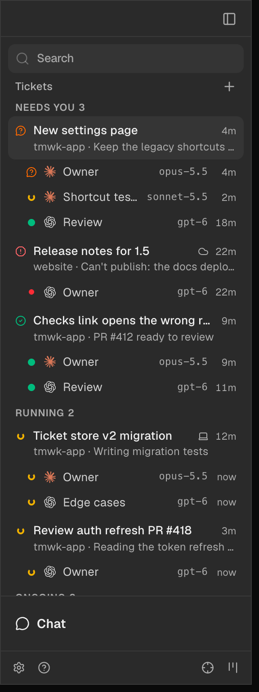
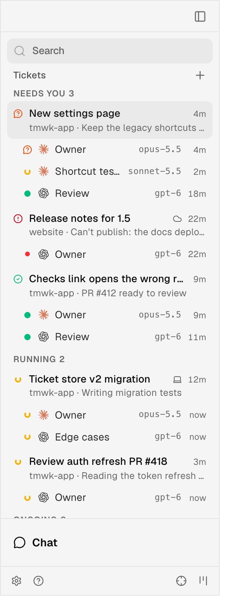

# A · Ticket tree

 

**What it is.** VISION read literally. Tickets are grouped by state (Needs you, Running, Ongoing, Done), and every session sits beneath its ticket with agent, role, model and age, like the Orca reference sidebar with tickets where worktrees were.

**Why.** "The sidebar is organized by ticket, with sessions beneath" is the M4 milestone's own wording. It gives full visibility with no clicks.

**Trade-offs.** Session rows outnumber tickets about 2:1, so eight tickets already push Ongoing below the Chat dock. Model strings and repeated owner states take more room than the outcome, and the actual question truncates. It reads as Orca's management view with ticket names on it.

**Codex, round 1.** "Cut as a default … this is Orca's management burden wearing ticket names. Keep its expanded subtree as an inspection state."

**Response.** Agreed. The nested session rows survive as the disclosure state in the finalists (one ticket at a time, status + agent + role only); models moved to the ticket view.
