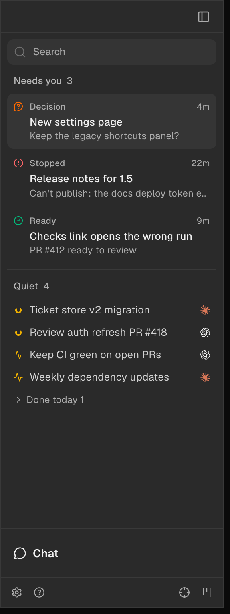
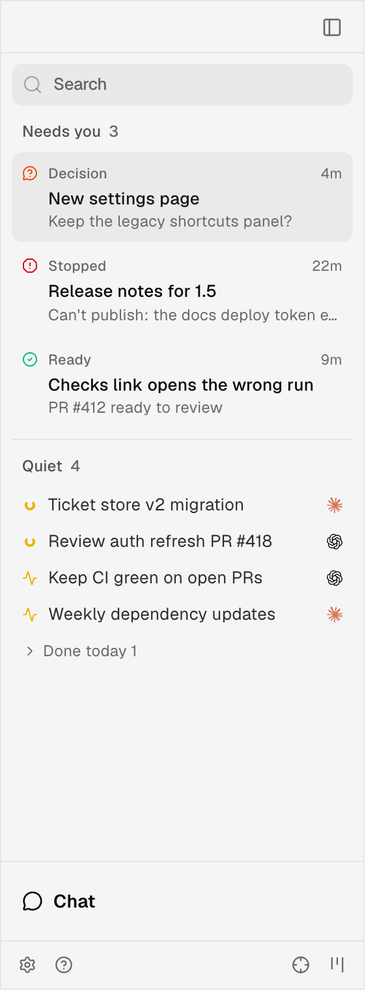

# B · Needs-you inbox

 

**What it is.** Only decision, stop and result get room: a category line, the title and the reason. Quiet work is one line each, with the owner's agent logo. Done collapses to "Done today".

**Why.** VISION's attention model ("What needs me?" returns decisions, then stops, then results) and Claude Duet's "things in progress and things that need you" split. Linear's agent sessions also separate `awaitingInput` from `active`.

**Trade-offs.** Three lines per attention item; no way into sessions from the sidebar; logos explain little.

**Codex, round 1.** "Finalist. Best attention allocation … remove the separate category line where the reason explains it … provide session disclosure. Quiet must not mean inaccessible."

**Response.** It became the base of Finalist 1: the category line is gone (the glyph plus the reason carry it), logos are gone, sessions are a disclosure, and "Done today" became "Done" so older history is not hidden.
