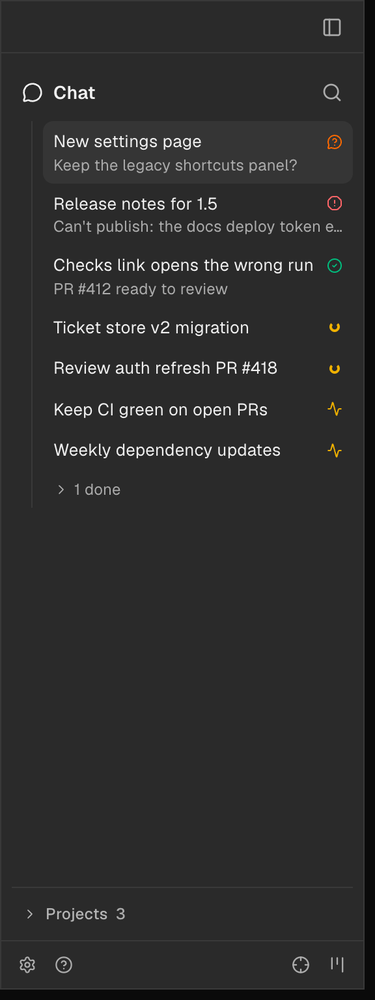
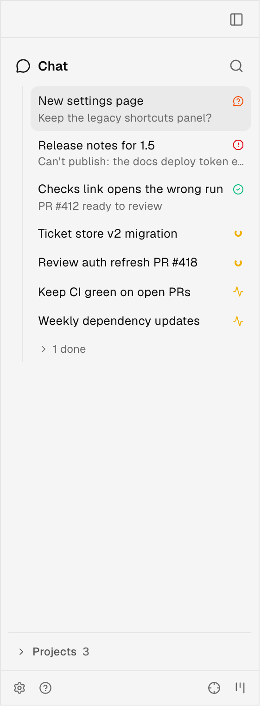

# C · Chat-rooted threads

 

**What it is.** Chat moves from the bottom dock to the top of the sidebar, and tickets hang off it on a guide line like threads off one conversation. No utility links; Projects collapse to one row at the bottom.

**Why.** "Communication is single-threaded; execution is not." Duet's one ongoing thread with work under it, and Dots/Grok Bot's conversation-first entry.

**Trade-offs.** Tickets read as more chat threads, which suggests several interchangeable conversations, the opposite of single-threaded. No section label explains the order. No sessions.

**Codex, round 1.** "Finalist, substantially revised … keep Chat prominent; label the ticket section independently and add disclosure. Collapsed Projects is a good escape hatch."

**Response.** It became Finalist 2: the thread line is gone, Tickets is its own labeled section with the shared row grammar and disclosure, and Projects stays collapsed at the bottom.
