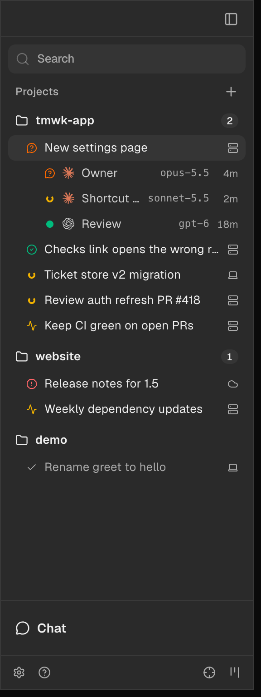
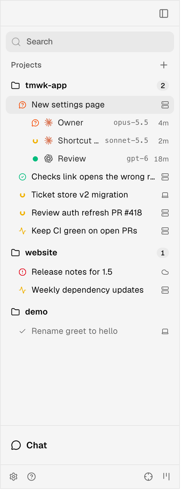

# E · Projects first

 

**What it is.** Today's Projects tree, with tickets where worktrees are, a host icon on every row, sessions under the selected ticket, and a needs-you count per project.

**Why.** It is the smallest change from today's sidebar, and the habit Orca users already have.

**Trade-offs.** Attention is split across projects: the stopped website ticket sits under healthy tmwk-app work. Host icons on every row make machines a first-class concept, which VISION says they are not.

**Codex, round 1.** "Cut … it preserves today's organizing habit instead of the intended attention model. Offer project filtering, not project-first triage." It also caught that the project count (2) disagreed with the five tickets shown.

**Response.** Cut. Projects became the "All projects" filter in every finalist; hosts appear only when they explain a problem.
