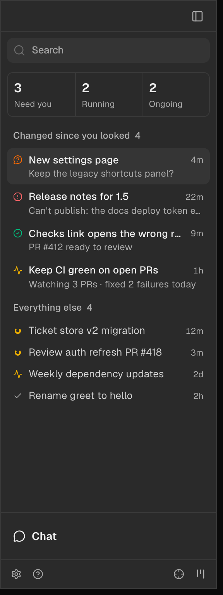
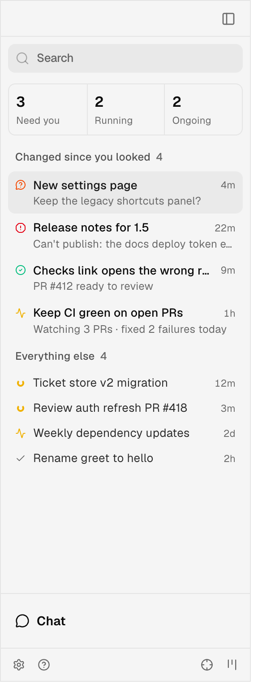

# F · Since you looked

 

**What it is.** A count strip (need you / running / ongoing), then "Changed since you looked", then "Everything else". The sidebar as a standing version of the "while you were away" message.

**Why.** VISION's away message and Hermes' recent-activity ordering. It shows what owners handled ("Watching 3 PRs · fixed 2 failures today").

**Trade-offs.** Changed is not needs-you: reading a decision would demote an unanswered question into "Everything else". The strip repeats the list.

**Codex, round 1.** "Cut as navigation; retain its summaries … use change markers and handled summaries inside B or the away message."

**Response.** Cut. Its handled summary survives as the second line of a quiet ongoing ticket in every finalist ("Fixed 2 CI failures today").
