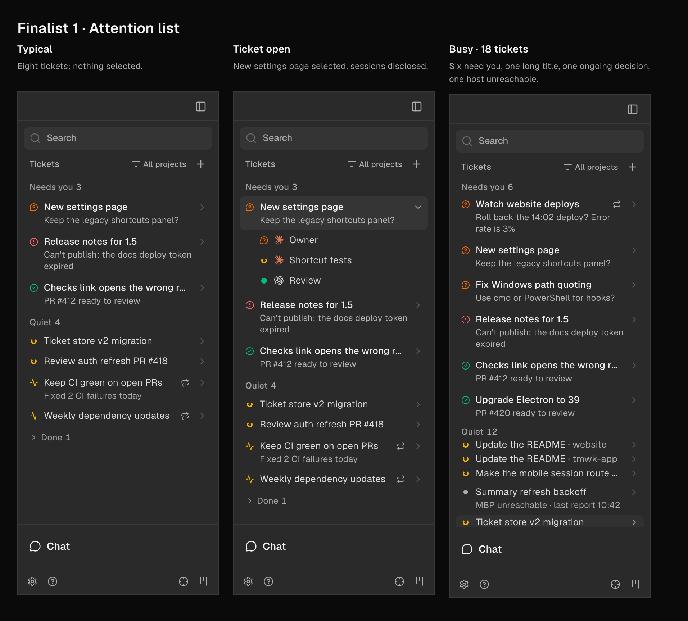
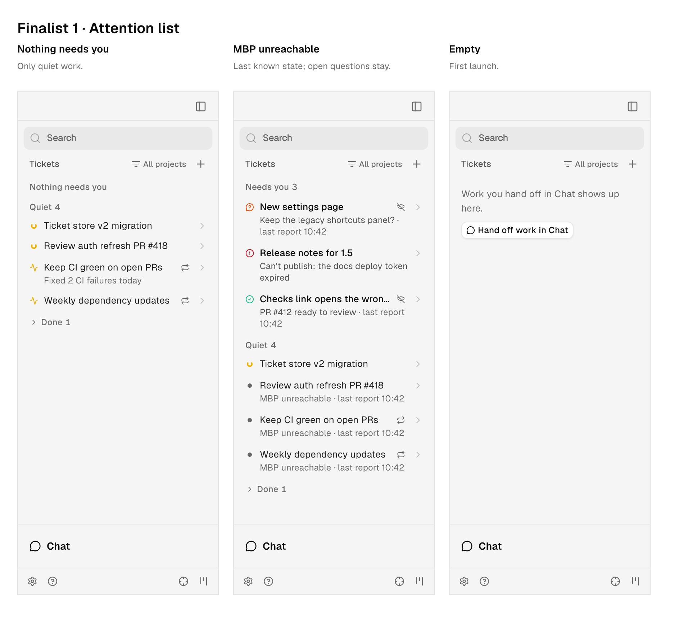
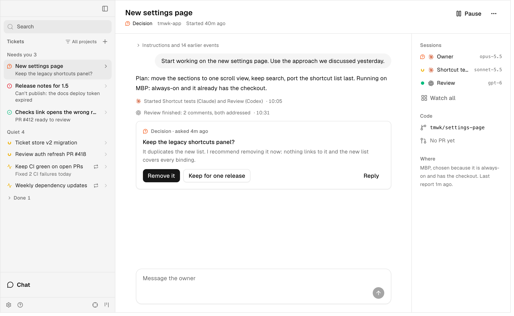
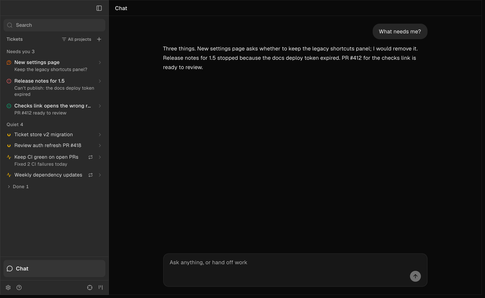

# Finalist 1 · Attention list (recommended)

Light/dark pairs: `f1-states-a`, `f1-states-b`, `f1-ticket-open`, `f1-chat-open` (`-dark.png`, `-light.png`).

**What it is.** The sidebar is a list of tickets under **Tickets**, merged from B and D. Chat stays in today's compact dock.

- **Needs you:** decisions, then stops, then results. Each row shows its title and the actual question, blocker or result as a second line of up to two lines.
- **Quiet:** every other active ticket on one line. A quiet ongoing ticket adds what it handled on its own ("Fixed 2 CI failures today").
- **Done:** one collapsed row with a count.
- **Sessions:** each row has a separate disclosure chevron that opens its sessions beneath it (status, agent and role).
- **Hosts:** appear only when they explain something (an unreachable host shows "MBP unreachable · last report 10:42" with a neutral dot).
- **Projects:** a filter ("All projects"). A project name appears in a row only when two titles collide ("Update the README · website").

**Why.** It is the shortest route from VISION to the screen:

- The unit of attention is the ticket, and "What needs me?" order is the list order.
- Quiet work stays visible on one line.
- Sessions sit beneath tickets, one disclosure away.
- Chat is always one click away, and the attention list stays in view while you talk.

It carries Orca's power (sessions, agents, hosts) behind disclosure, and grokbot/Dots' simplicity (one conversation, a short list of what matters) in front.

**Trade-offs.**

- Chat in the bottom dock undersells the main conversation compared with F2.
- Busy (18 tickets) needs real scrolling and keyboard checks that PNGs cannot show.
- Replacing today's Projects/worktree navigation with a filter means folder workspaces and raw worktrees need another route. The ticket view's Code section and the existing workspace views are the candidates, and none is drawn here.

**Codex, round 2.** Ranked first: "Best M4 default: decisions, stops and results remain visible while I converse or inspect another ticket." Flaws it found, and what changed:

| Codex flaw                                                           | Change                                                                                                                                               |
| -------------------------------------------------------------------- | ---------------------------------------------------------------------------------------------------------------------------------------------------- |
| Chat said "Nothing needs you" beside three needs                     | Chat's answer is now derived from the same tickets and names all three.                                                                              |
| "Running 4" contained unreachable and waiting tickets                | The section is **Quiet**; unreachable tickets keep a neutral dot and say so.                                                                         |
| "PR #420 ready · 1 open question" mixed result and decision          | Now "PR #420 ready to review"; a question would make it a decision.                                                                                  |
| Reasons truncated                                                    | Attention reasons get two lines.                                                                                                                     |
| Disclosure shown on one row only                                     | Every ticket shows the same chevron, muted until hover/selection; selecting does not expand. The ticket-open view starts with the subtree collapsed. |
| Duplicate titles indistinguishable                                   | The project is appended only when titles collide.                                                                                                    |
| Stop and result differed only in hue                                 | Stop is an octagon alert, result a circled check; accepted is a muted check.                                                                         |
| "Needs you 0", unexplained empty state                               | "Nothing needs you" replaces the zero; the empty state has a "Hand off work in Chat" button.                                                         |
| "Host lost: the Ona environment stopped" conflated two VISION states | The stop is now a real stop ("Can't publish: the docs deploy token expired").                                                                        |
| "Fix flaky checks detail link" read like leaked implementation copy  | Renamed "Checks link opens the wrong run".                                                                                                           |
| Ticket header repeated model and host from the rail                  | The header shows state, project and start; the rail owns sessions, code and placement.                                                               |

**Not addressed (left for implementation):** whether the plus opens a "New ticket" composer or routes to Chat, keyboard and touch disclosure, scroll and selection preservation when priority changes, narrow and mobile rail folding, the full set of host states (Codex's list below), and evidence beside result acceptance.
