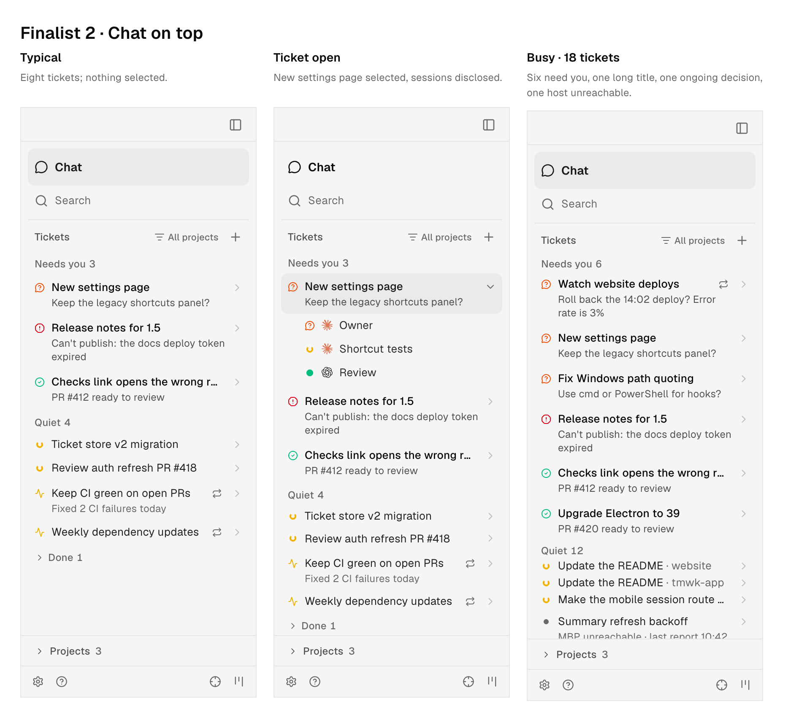
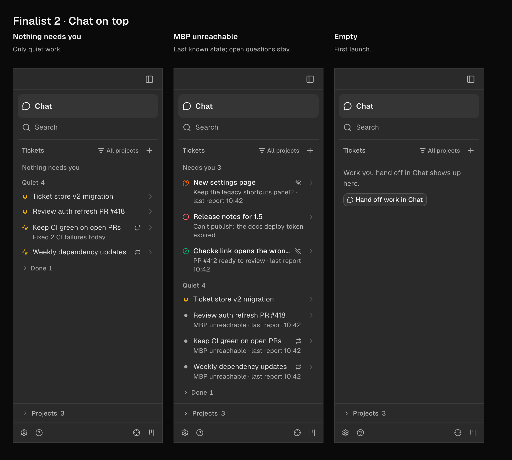

# Finalist 2 · Chat on top

Light/dark pairs: `f2-states-a`, `f2-states-b`.

**What it is.** C revised. **Chat** is the first row of the sidebar, with Search beneath it. A separately labeled **Tickets** section uses exactly F1's rows, and Projects collapses to one row at the bottom. There is no bottom dock and no utility links.

**Why.** It is the most literal statement of "one main conversation; execution is not single-threaded." It matches Duet and grokbot, where the conversation is the front door and work hangs under it.

**Trade-offs.**

- Chat, Search, a divider and two headings push work down about 90 px compared with F1.
- Projects is a second navigation system at the bottom.
- It removes the Chat dock that PR #34 just shipped.

**Codex, round 2.** Ranked second, "a close second, and a better statement of the vision's conversational center … I would move it first if laptop-sized interaction checks show faster return to Chat without materially hiding quiet work."

**Response.** Kept as the alternative. Because the rows are identical, F1 and F2 differ only in where Chat sits. Shipping F1 first keeps F2 a one-file change if dogfooding shows Chat is reached too slowly from the dock.
