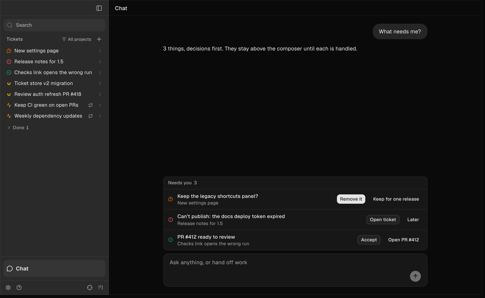
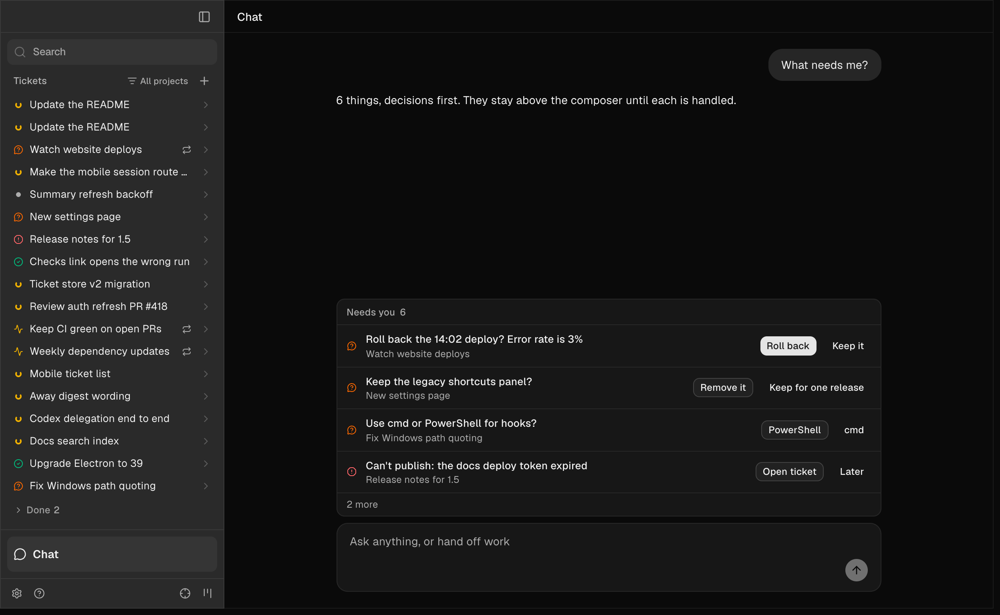
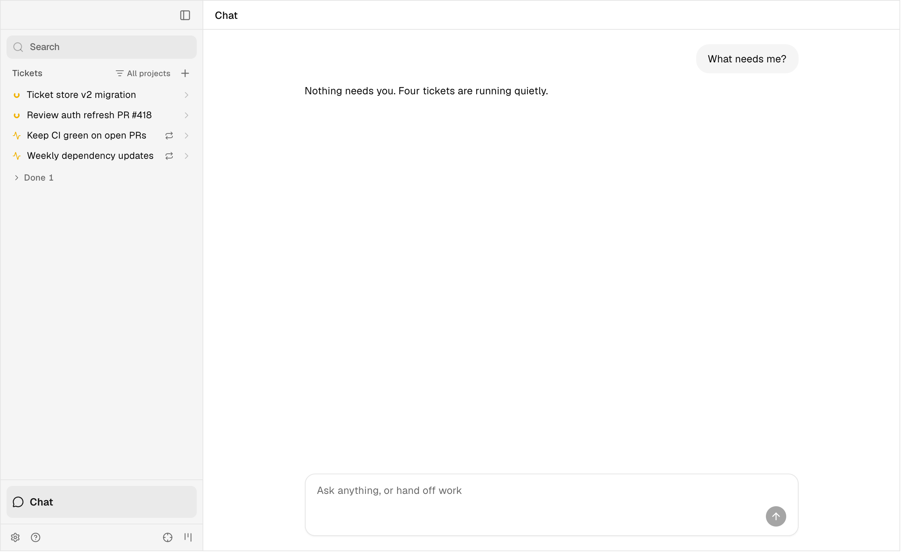

# Finalist 3 · Shelf and queue

Light/dark pairs: `f3-typical`, `f3-busy`, `f3-quiet`.

**What it is.** Codex's round-1 "missing experiment," which separates navigation from triage.

- **The shelf:** the sidebar lists tickets in creation order and never re-sorts, so a row never moves when its attention is resolved.
- **The queue:** what needs you sits above the Chat composer, with the actual question and one-click answers ("Remove it", "Roll back").

**Why.** Stable positions build spatial memory, as in Things or a Slack channel list. Answering a decision where you are already typing is the Duet/OpenClaw approval-card pattern.

**Trade-offs.** The sidebar loses its reasons, so the sidebar alone no longer answers "what needs me?". The queue exists only in Chat, so it disappears while you inspect a ticket. Six items become four rows plus "2 more" and crowd the conversation.

**Codex, round 2.** Ranked third: "stable navigation is valuable, but this version purchases it by hiding reasons in the sidebar and bolting an action dashboard onto the composer." It also flagged "Retry on MBP" as promising recovery that VISION defers.

**Response.** Not recommended as the default. "Retry on MBP" became "Open ticket". The one-click answer is worth keeping: the decision card in the ticket view and the partner's "What needs me?" answer already provide it without a second queue surface.
