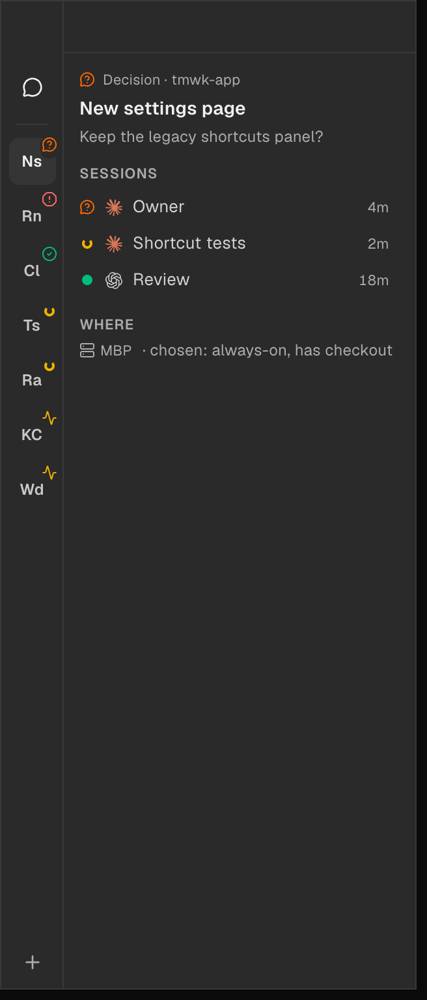
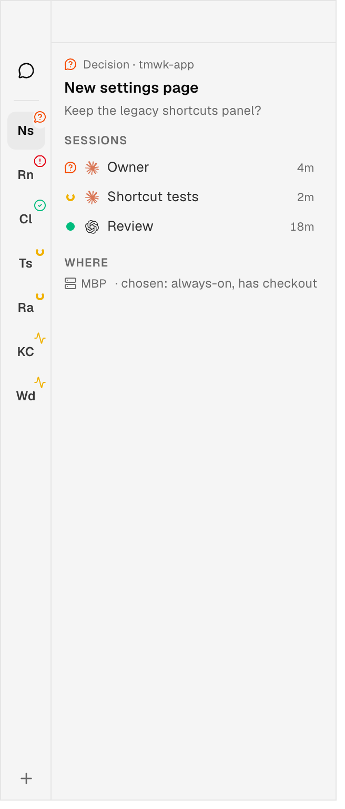

# G · Rail and panel

 

**What it is.** A 48 px rail of ticket monograms with status badges (Slack/Discord style), Chat at its top; the selected ticket's detail (state, sessions, where and why) fills the panel.

**Why.** It is the most different shape, and it keeps one ticket's detail always visible without opening anything.

**Trade-offs.** Monograms (Ns, Rn, Ff) cannot be scanned; more tickets make it worse. The overview is sacrificed to one ticket's machinery.

**Codex, round 1.** "Cut … the rail makes every other ticket a memorization test … reuse the detail content after opening a named ticket."

**Response.** Cut. Its detail panel (sessions, where and why) became the ticket view's right rail.
