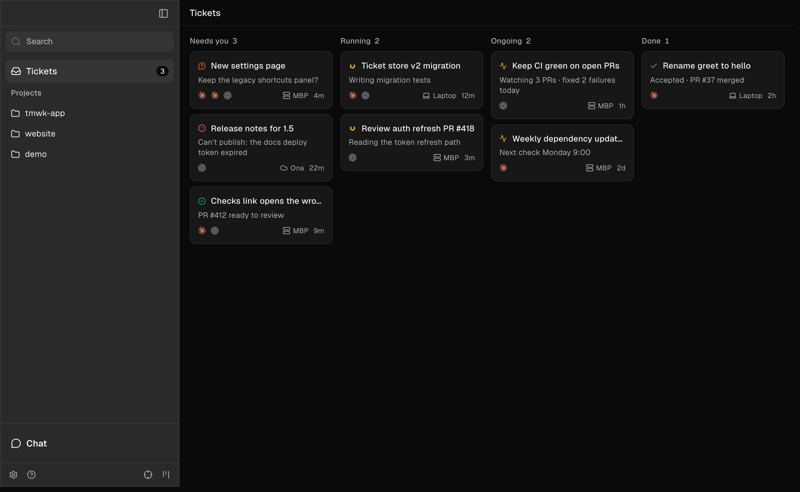
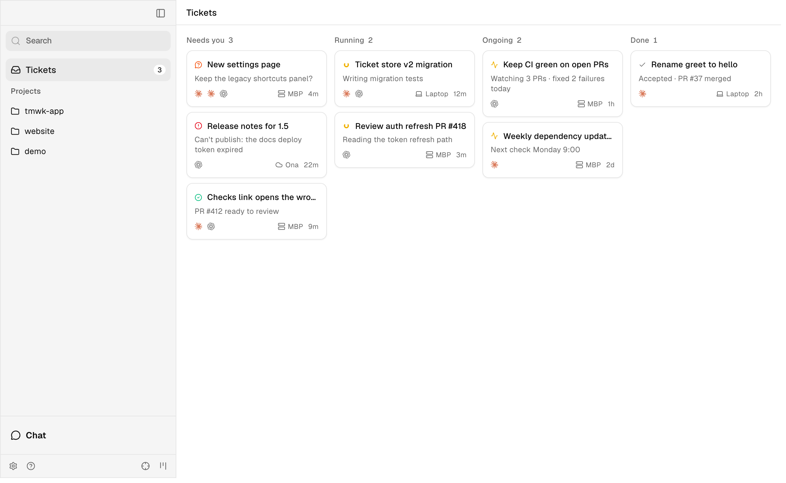

# H · Tickets page

 

**What it is.** The sidebar stays small (a Tickets entry with a needs-you count, then Projects); the overview is a four-column board in the main area. Hermes' Kanban board and Linear's delegate views are the references.

**Why.** Cards have room for progress text, sessions and hosts, and the sidebar stays almost empty.

**Trade-offs.** Quiet work disappears whenever Chat is open, which breaks "keep quiet work visible", and a whole column goes to one accepted ticket. It does not meet the M4 milestone, which is about the sidebar.

**Codex, round 1.** "Cut as the M4 replacement … keep a full overview as an optional expansion, preferably a list."

**Response.** Cut for M4. A full-page list remains a possible later expansion, not part of the recommendation.
