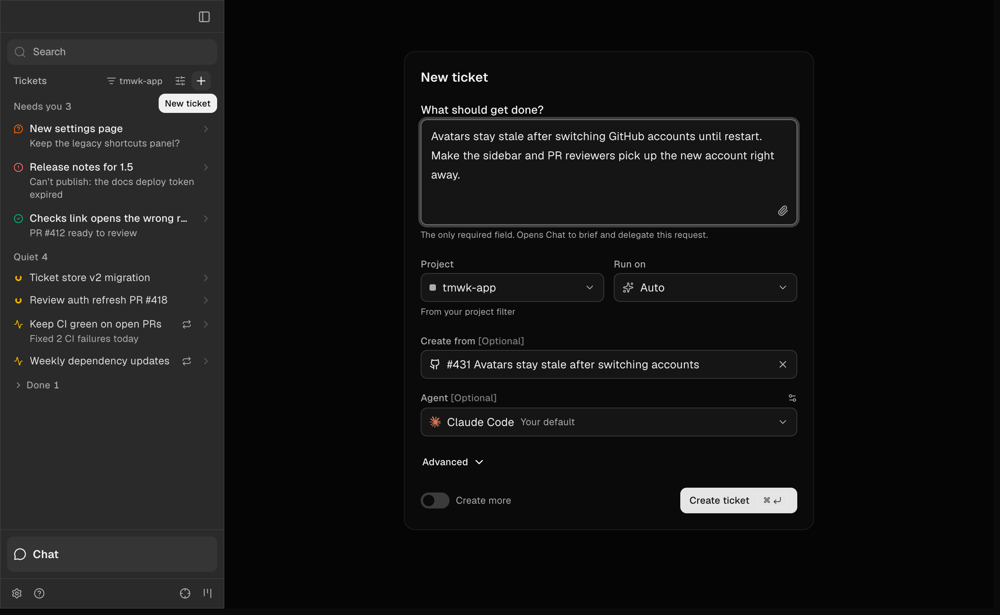

# Round 3 · New ticket

| Image                                                                                                                  | What it shows                                                                 |
| ---------------------------------------------------------------------------------------------------------------------- | ----------------------------------------------------------------------------- |
| `new-ticket-sheet` ([dark](../images/new-ticket-sheet-dark.png) · [light](../images/new-ticket-sheet-light.png))       | The sidebar's + is New ticket; the sheet filled in, project from the filter.  |
| `new-ticket-compare` ([dark](../images/new-ticket-compare-dark.png) · [light](../images/new-ticket-compare-light.png)) | Today's New worktree beside the empty New ticket, with Run on open.           |
| `new-ticket-chat` ([dark](../images/new-ticket-chat-dark.png) · [light](../images/new-ticket-chat-light.png))          | The request lands in Chat as an event; the partner picks it up and delegates. |
| `new-ticket-clarify` ([dark](../images/new-ticket-clarify-dark.png) · [light](../images/new-ticket-clarify-light.png)) | The partner asks first; the ticket waits in Needs you as a decision.          |

## What it is

The + at the right of the Tickets header opens **New ticket**, a sheet built from the same parts as today's Create worktree modal, in the same order:

| Create worktree (today)                 | New ticket                                                                                                                           |
| --------------------------------------- | ------------------------------------------------------------------------------------------------------------------------------------ |
| Project, Run on                         | Below the description. Project prefilled from the project filter. Run on: **Auto** (default), Local Mac, mbp                         |
| Create From: name a worktree, or search | **Create from [Optional]**: a branch, GitHub issue or PR, or Jira URL as context. No naming: the owner picks the branch and worktree |
| Agent [Optional]                        | Agent [Optional], showing "Your default"                                                                                             |
| Advanced                                | Advanced (setup, base branch)                                                                                                        |
| Create more · Create ⌘↵                 | Create more · **Create ticket ⌘↵** (Save as draft cut after round 3)                                                                 |
| —                                       | **What should get done?**: the large first field, and the only required one                                                          |

Submitting opens Chat. The request does not appear as a message bubble from you. It lands as a **timeline event**: a divider line ("You requested a new ticket · 10:48") over a quiet card with the title, the description and the fields as chips. The partner answers in its own voice, either:

- **Delegates**: a one-line plan ("Picked it up. The brief: reproduce with two accounts first, then open a draft PR."), then system lines "Brief ready" and "Delegated to Claude Code on mbp, where tmwk-app is checked out · Open ticket". The ticket appears under Quiet as "Owner starting · just now".
- **Asks first**: one question about a real open trade-off, with the partner's recommendation as the primary answer and free text always allowed. Until you answer, the ticket sits in Needs you as a decision, so the sheet never creates work that silently waits.

## Why

- The sheet keeps the muscle memory of Create worktree, but asks for the outcome rather than a branch name, in line with VISION's "the unit of attention is the ticket and its outcome".
- An event, not a message, marks the request as structured input the partner acts on. It keeps the conversation readable and makes the fields auditable later in the thread.
- Run on: Auto matches the round-2 rule that hosts appear only when they explain something. The partner's acknowledgement says where the work ran and why, once.

## Trade-offs

- Two ways to start work (the sheet and typing in Chat) produce the same event. That is the point, but it is a second entry.
- The title is drafted from the description. The event shows it so you can correct it in your reply.

## Codex critique (round 3) and my response

Full critique: [round-3-codex.md](../critique/round-3-codex.md). Codex kept F1 and the bottom dock, and judged that the event "does read as an event".

| Critique                                                                                            | Response                                                                                                                                                                                                                                                                   |
| --------------------------------------------------------------------------------------------------- | -------------------------------------------------------------------------------------------------------------------------------------------------------------------------------------------------------------------------------------------------------------------------- |
| The clarifying question asked something the request already answered.                               | **Fixed.** It now asks a real open trade-off (cancel in-flight avatar loads from the old account?) with a recommendation, a primary answer and a free-text path. The Needs you row carries the same question.                                                              |
| The acknowledgement repeats the delegation and adds host trivia; "Delegated" needs confirmed state. | **Fixed.** A short plan in the partner's voice, then two system lines: "Brief ready" and "Delegated to Claude Code on mbp, where tmwk-app is checked out", with Open ticket. The event keeps "Run on Auto" as the intent; the delegation line states the actual placement. |
| Cut Save as draft; keep Create more and define it against opening Chat.                             | **Done.** Save as draft is cut; unfinished input survives dismissal. With Create more on, submit opens Chat and reopens the cleared sheet over it with Project kept; switch it off to finish.                                                                              |
| The source field is a searchable picker, not a URL box.                                             | **Fixed.** A search field: "Search branches, issues and PRs, or paste a Jira URL". Reuse-versus-context for a branch, host connection and project setup recovery stay as in today's composer; not redrawn.                                                                 |
| Helper copy; "SSH · idle" implies load awareness we don't have.                                     | **Fixed.** "Opens Chat to brief and delegate this request." The mbp row says "SSH · tmwk-app here".                                                                                                                                                                        |
| Advanced may be empty once naming is gone.                                                          | **Kept, noted.** It still holds the base branch and setup policy. If those move to the owner, drop it.                                                                                                                                                                     |
| A timestamp on the earlier "Three things" answer.                                                   | **Fixed** (10:41, before the 10:48 request).                                                                                                                                                                                                                               |
