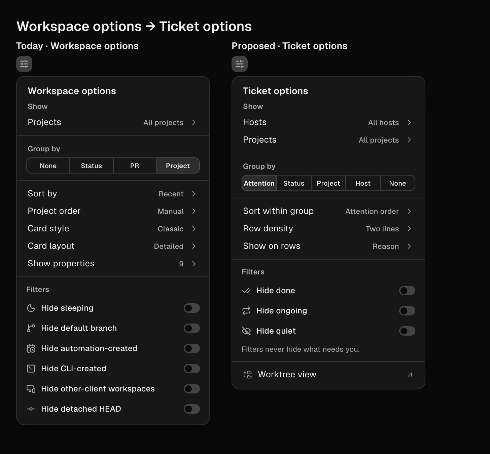

# Round 3 · Ticket options and custom status order

| Image                                                                                                            | What it shows                                                                             |
| ---------------------------------------------------------------------------------------------------------------- | ----------------------------------------------------------------------------------------- |
| `options-compare` ([dark](../images/options-compare-dark.png) · [light](../images/options-compare-light.png))    | Today's real Workspace options menu beside Ticket options.                                |
| `options-submenus` ([dark](../images/options-submenus-dark.png) · [light](../images/options-submenus-light.png)) | Sort within group and Show on rows open.                                                  |
| `options-results` ([dark](../images/options-results-dark.png) · [light](../images/options-results-light.png))    | Default (Attention); Project, one line, PR on rows; Host with project, agent and age.     |
| `status-order` ([dark](../images/status-order-dark.png) · [light](../images/status-order-light.png))             | Status order mid-drag, the resulting sidebar (Done, Blocked, then the rest), the default. |

The left menu in `options-compare` is the real `WorkspaceOptionsMenuItems`. Its Hosts row is missing only because the fixture has no remote hosts. Ticket options is built from the same primitives: `DropdownMenuLabel`, the outline `ToggleGroup` for Group by, `DropdownMenuSubTrigger` rows with the value on the right, and the real `FilterToggleRow`.

## Ticket options (replacing Workspace options)

| Today (worktrees)                                                                      | Ticket options                                                                                                                                                                                      |
| -------------------------------------------------------------------------------------- | --------------------------------------------------------------------------------------------------------------------------------------------------------------------------------------------------- |
| Show: Hosts, Projects                                                                  | Kept as filters                                                                                                                                                                                     |
| Group by: None / Status / PR / Project                                                 | Group by: **Attention** (default) / Status / Project / Host / None                                                                                                                                  |
| Sort by: Agent activity, Recent…                                                       | Sort within group: **Attention order** (decisions, stops, results) / Last activity / Newest / Oldest                                                                                                |
| Card style, Card layout                                                                | Row density: two lines with the reason, or one line                                                                                                                                                 |
| Show properties (9)                                                                    | Show on rows: Reason (default), Project, Host, Agent, Last activity, PR                                                                                                                             |
| Filters: sleeping, default branch, automation/CLI-created, other-client, detached HEAD | Filters: Hide done, Hide ongoing, Hide quiet ("Filters never hide what needs you"). The worktree filters, PR grouping and Project order move to the worktree view, linked at the bottom of the menu |

- Show on rows keeps the round-2 rules: a project still appears when two titles match, and a host when it explains a problem. The submenu says so.
- **Every grouping except Attention gets the pinned Needs you strip** (count plus decision, stop and result counts). Grouping by project or host can push a decision below the fold; the strip keeps "what needs me" one glance away in every arrangement.

## Custom status order

With Group by Status, a **Status order…** row appears under the toggle. It opens a small, stable popover (round 3 moved it out of a cascading submenu):

- A pinned note on top: "The Needs you count stays above every section, and decisions still reach you in Chat." It is not a list row and cannot be dragged.
- Seven status sections with grips: Needs decision, Blocked, Ready for review, Running, Waiting, Paused, Done. In the image, Blocked is mid-drag with the drop line under Done, and Ready for review has keyboard focus (⌥↑↓ moves it).
- "Saved for you" and Reset to default.

The resulting sidebar puts Done (4) first, then Blocked, then the rest. The pinned strip still shows Needs you 3 (1 decision, 1 stop, 1 result) at the top, and decisions keep arriving in Chat however the sections are ordered.

## Trade-offs

- Five Group by choices is one more than today's toggle. At 10px the labels fit in the 288px menu, but there is no room for a sixth.
- Ordering is per user, so two people looking at a shared screen can see different orders. The pinned strip is the shared anchor.

## Codex critique (round 3) and my response

Full critique: [round-3-codex.md](../critique/round-3-codex.md).

| Critique                                                                                           | Response                                                                                                                                                                                                                                                                   |
| -------------------------------------------------------------------------------------------------- | -------------------------------------------------------------------------------------------------------------------------------------------------------------------------------------------------------------------------------------------------------------------------- |
| One-line mode dropped every question and blocker; Host metadata truncated the stop reason.         | **Fixed.** Needs-you rows always keep their reason, clamped to two lines, at every density and whatever Show on rows says. Density and the Reason box shape quiet rows only. The Host example shows less metadata.                                                         |
| Hide ongoing must not hide an ongoing decision; the pin must stay actionable under filters.        | **Fixed in the rules and the copy.** "Filters never hide what needs you." The pinned strip counts across row filters and collapsed groups. Its scope under a project or host filter, the active-filter badge and Clear filters are carried from today's menu, not redrawn. |
| Agent and Age are inspection power; label Age honestly.                                            | **Done.** Both are off by default; Age is now "Last activity".                                                                                                                                                                                                             |
| Replace the worktree-filter paragraph with a real route; don't drop PR grouping and Project order. | **Fixed.** A "Worktree view ↗" item ends the menu. PR grouping, manual Project order and the worktree filters live there, keeping existing preferences.                                                                                                                    |
| Group by None should read "Sort by".                                                               | **Agreed.** It's a label change, not drawn.                                                                                                                                                                                                                                |
| Ongoing is a kind, not a status.                                                                   | **Fixed.** The bucket is now "Waiting" (between runs); ongoing tickets keep their repeat mark in whichever status they're in, including Needs decision.                                                                                                                    |
| Drag inside a cascading submenu is fragile.                                                        | **Fixed.** "Status order…" opens a stable popover: drag handles, ⌥↑↓ on the focused row, Reset to default. The pinned-count explanation sits above the list, not as a fake row.                                                                                            |
| Scroll pinning and decision delivery to Chat aren't proven by a PNG.                               | **Agreed.** Listed under "Not tested" in the README.                                                                                                                                                                                                                       |
