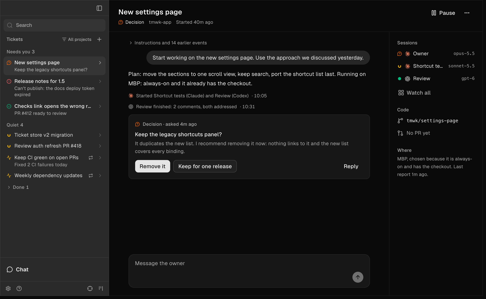

# Opening a ticket

| View                                       | Dark                                        | Light                                        |
| ------------------------------------------ | ------------------------------------------- | -------------------------------------------- |
| T1 · Page                                  | [PNG](../images/open-page-dark.png)         | [PNG](../images/open-page-light.png)         |
| T2 · Conversation                          | [PNG](../images/open-conversation-dark.png) | [PNG](../images/open-conversation-light.png) |
| T3 · Watch all                             | [PNG](../images/open-watch-dark.png)        | [PNG](../images/open-watch-light.png)        |
| **T4 · Conversation + rail (recommended)** | [PNG](../images/f1-ticket-open-dark.png)    | [PNG](../images/f1-ticket-open-light.png)    |

- **T1 · Page:** a report. Decision card, work history table, and a side column for sessions, code and placement. Clear, but it feels like reading about the work rather than directing it.
- **T2 · Conversation:** the ticket opens as the owner's thread. Work history is the transcript, events are quiet lines, the decision is an inline card and the composer says "Message the owner". Sessions crowd into the header.
- **T3 · Watch all:** every session side by side, tmux-style, each typeable; "the owner sees it" is the design intent from VISION's "Watching and working alongside agents", and it needs real work-history delivery to be true. It is the deeper level, reached from "Watch all".
- **T4 · Conversation + rail:** T2's thread with T1's side column. Sessions (with models), Watch all, Code (branch, PR) and Where (host and why, last report) sit in a quiet rail. The header holds only title, state, project and start, plus Pause and a menu.

**Codex, round 2.** "The rail hybrid wins: owner conversation for direction, retained events for accountability, Code/Where/Sessions for inspection." It asked to drop the header's duplicated model and host and to collapse the sidebar subtree when a ticket opens. Both are done in T4. It also asked to keep pending decisions reachable after long histories, show goal and instructions on demand (the "Instructions and 14 earlier events" row), give evidence beside result acceptance, and fold the rail on narrow and mobile layouts. Those are left for implementation.
