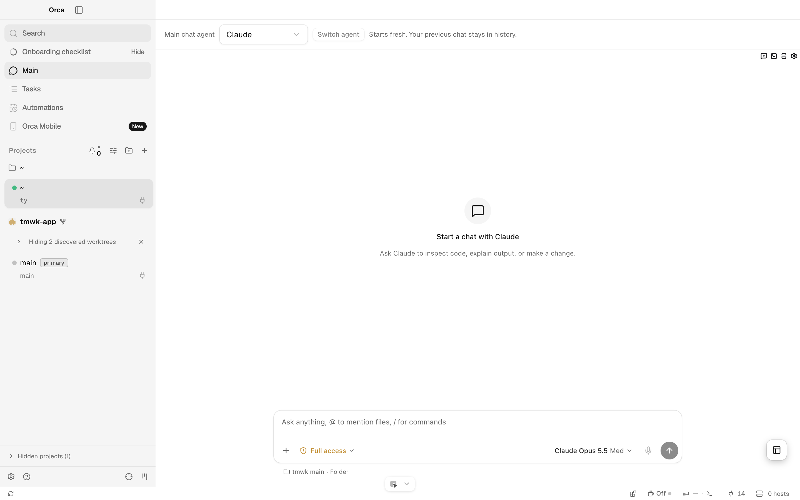
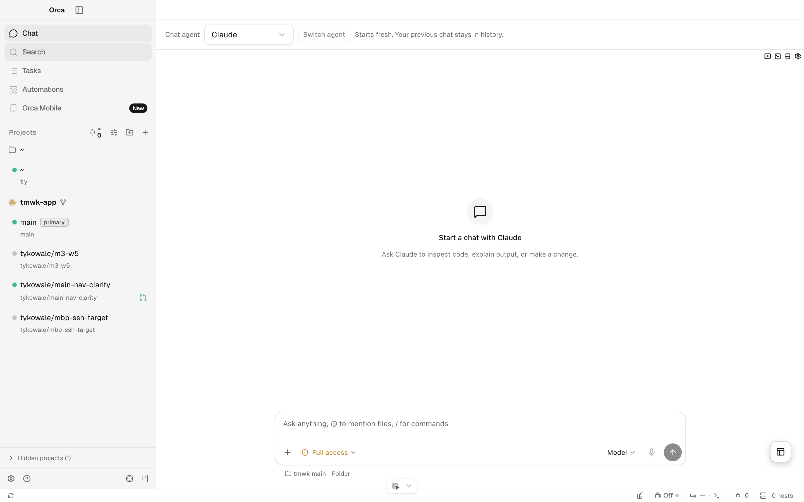
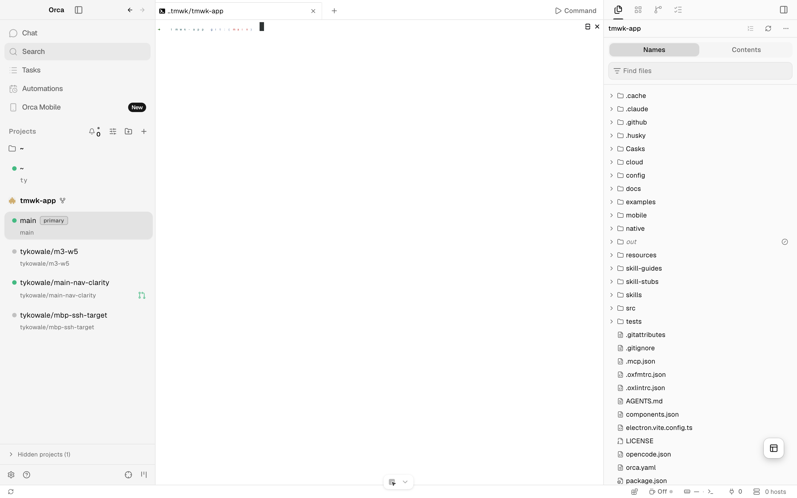

# Chat selection clarity

**Chat** is a compact, single-line destination above Search, outside Projects. Opening it
clears the remembered workspace's displayed highlight while preserving that workspace for
return navigation. The project's literal `main` name and primary badge stay unchanged.

There is no scope subtext, separate Chat block or added content header. The existing agent
toolbar says **Chat agent**, which also identifies the conversation with the sidebar closed.
Inactive hover is quieter than current selection; a focus-visible ring identifies keyboard
focus independently of the selected destination.

| Context                  | Before                                          | After                                         |
| ------------------------ | ----------------------------------------------- | --------------------------------------------- |
| Chat                     |             |             |
| Primary `main` workspace |  |  |

Additional captures:

| State                                 | Light                                  | Dark                                       |
| ------------------------------------- | -------------------------------------- | ------------------------------------------ |
| Chat selected                         | [Light](after-main-chat.png)           | [Dark](after-main-chat-dark.png)           |
| Primary `main` selected               | [Light](after-project-main.png)        | [Dark](after-project-main-dark.png)        |
| Visible nonprimary workspace selected | [Light](after-project-worktree.png)    | [Dark](after-project-worktree-dark.png)    |
| Keyboard focus on inactive Chat       | [Light](after-chat-focus-inactive.png) | [Dark](after-chat-focus-inactive-dark.png) |
| Keyboard focus on current Chat        | [Light](after-chat-focus-active.png)   | [Dark](after-chat-focus-active-dark.png)   |

Also: [collapsed sidebar](after-main-chat-collapsed.png), [narrow Chat](after-main-chat-narrow.png),
and [narrow project](after-project-main-narrow.png).

## Validation

The app runs in the background with `/tmp/tmwk-nav-review/ud` as an isolated profile and
`/tmp/tmwk-nav-review/tmwk` as its main-chat home. A clean launch environment includes
`ORCA_BACKGROUND_LAUNCH=1`, `VITE_EXPOSE_STORE=true`, renderer port 15477 and CDP port 9477.
Playwright uses CDP against the hidden renderer; no OS window activation is used. DOM focus
and keyboard events stay inside that renderer. The unavailable `$electron` skill is replaced
by the repo's documented CDP pattern, as authorized earlier in this task.

Current screenshots use a 1440 × 900 CSS viewport, with 800 × 700 for narrow captures, at 2×
display scale. The original before-project capture uses 1710 × 1073. The project is the
existing `tmwk-app` checkout with its primary `main` and visible `tykowale/main-nav-clarity`
worktree. The conversation is an empty, real Claude session. Pointer screenshots place the
pointer over content, outside the sidebar; keyboard screenshots deliberately show focus.

DOM assertions passed in light and dark for:

- Chat current with no current workspace rows or active workspace cards, including after
  focus moves into the composer.
- Primary `main` current with Chat idle and exactly one active workspace card.
- The visible nonprimary workspace current with primary `main` and Chat idle, including
  after hovering Chat and moving the pointer away.
- Inactive Chat keyboard focus without changing the current workspace; Enter then selects
  Chat and removes the remembered-workspace highlight.
- Keyboard focus on current Chat distinct from its persistent current fill.
- Returning from Chat to a workspace and reopening Chat preserves exclusive selection.

Keyboard ArrowDown/Enter also activated one visible project workspace, and keyboard Enter
on Chat removed its highlight. Closing/reopening the sidebar preserved Chat selection and
left the existing Chat agent control visible. Both narrow states were captured. Screenshots
were visually inspected.

Local checks use `ORCA_BACKGROUND_LAUNCH=1`: `pnpm tc`, `pnpm check:changed` against
`origin/main`, and the existing sidebar-workspace-delete and selected-host-active-workspace-identity
tests with `--maxWorkers=2`. No copy or CSS tests were added.

Remote hosts, Windows/Linux and the separate mobile app were not exercised. This change
adds no platform-specific logic or new workspace identity handling. The ownership map logs
the sidebar registration and the single Extend selection exclusion; presentation stays in
Own main-chat files.
