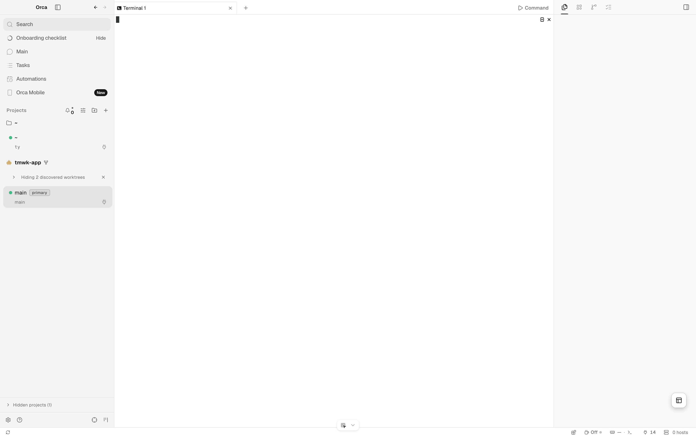

# Main chat and project context

Main chat now sits first in its own sidebar block, labeled **Main chat — Across all projects**.
The content area repeats that identity, including during startup or an unavailable home host.
Opening a project shows **Project workspace** and its project/workspace names instead.
The last project card no longer stays highlighted while Main chat is selected.

| Context                  | Before                                          | After                                         |
| ------------------------ | ----------------------------------------------- | --------------------------------------------- |
| Main chat                |        |        |
| Primary `main` workspace |  |  |

Additional screenshots: [nonprimary worktree](after-project-worktree.png),
[dark Main chat](after-main-chat-dark.png), [dark project main](after-project-main-dark.png),
[collapsed sidebar](after-main-chat-collapsed.png), [narrow Main chat](after-main-chat-narrow.png),
and [narrow project main](after-project-main-narrow.png).

## Validation

The background dev app used `/tmp/tmwk-nav-review/ud` as an isolated profile and
`/tmp/tmwk-nav-review/tmwk` as its main-chat home. It was launched with a clean environment,
`ORCA_BACKGROUND_LAUNCH=1`, `VITE_EXPOSE_STORE=true`, renderer port 15477 and CDP port 9477.
Playwright connected over CDP to the hidden renderer; no window activation or focus calls
were used. The unavailable `$electron` skill was replaced by this repo's documented CDP
pattern with the coordinator's authorization.

Screenshots use a 1440 × 900 CSS viewport, with 800 × 700 for narrow checks; the original
before-project capture uses the native 1710 × 1073 viewport. PNGs are at 2× display scale.
The project is the existing `tmwk-app` checkout, with its primary `main` workspace and
detected `tykowale/main-nav-clarity` worktree. The main chat is an empty, real Claude session.

DOM assertions verified the Main chat heading, no active workspace cards in Main chat,
an inactive Main chat navigation entry in the project view, the primary and nonprimary
workspace headings, a folder workspace heading without duplicated names, and the
heading remaining visible with the sidebar collapsed. At 800 pixels wide with both
sidebars open, the primary workspace name `main` remains visible without truncation.
Light and dark screenshots were visually inspected.

Local checks:

- `ORCA_BACKGROUND_LAUNCH=1 pnpm tc`
- `ORCA_BACKGROUND_LAUNCH=1 pnpm check:changed` against `origin/main`
- `ORCA_BACKGROUND_LAUNCH=1 pnpm test src/renderer/src/components/sidebar/worktree-list/navigation/sidebar-workspace-delete.test.tsx src/renderer/src/store/slices/worktrees/session/selected-host-active-workspace-identity.test.ts --maxWorkers=2` — two tests passed

No copy or CSS tests were added. Remote hosts, Windows/Linux, and the separate mobile app
were not exercised; the heading reuses existing host-aware workspace/repository selectors
and introduces no platform-specific logic.

The fork ownership map records the one-line Extend selection exclusion in `WorktreeList`
and the shell/sidebar registration patches. Main-chat presentation stays in Own files.
